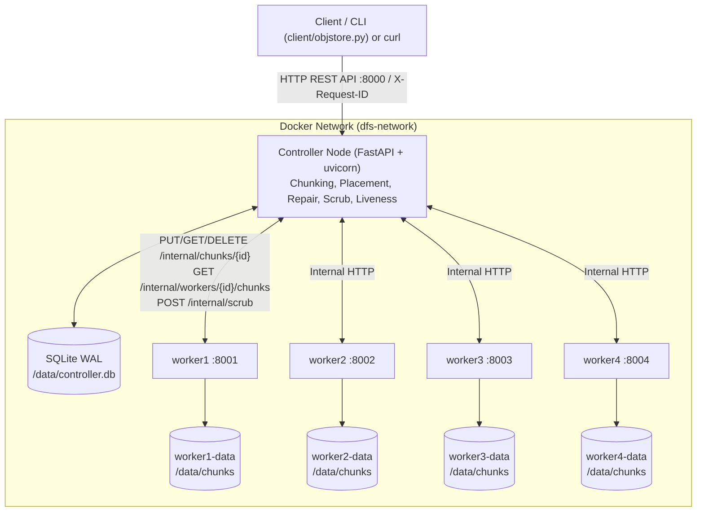
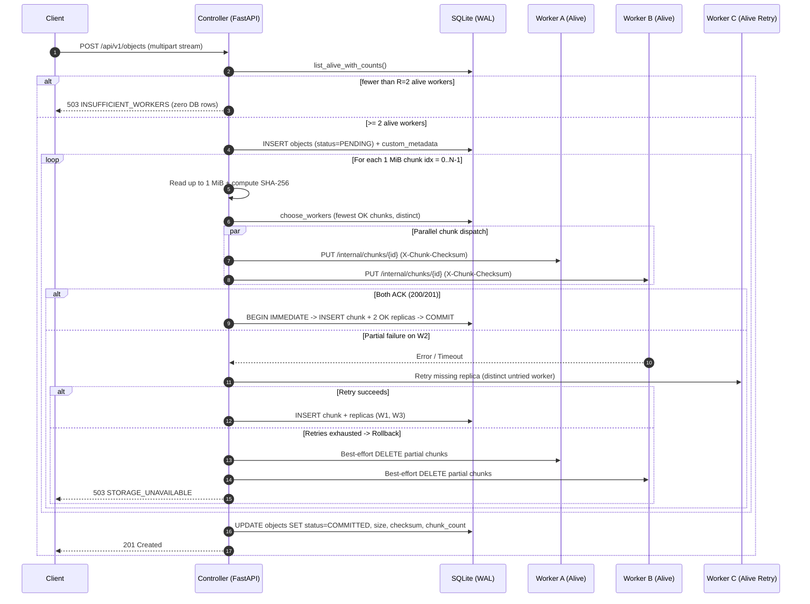
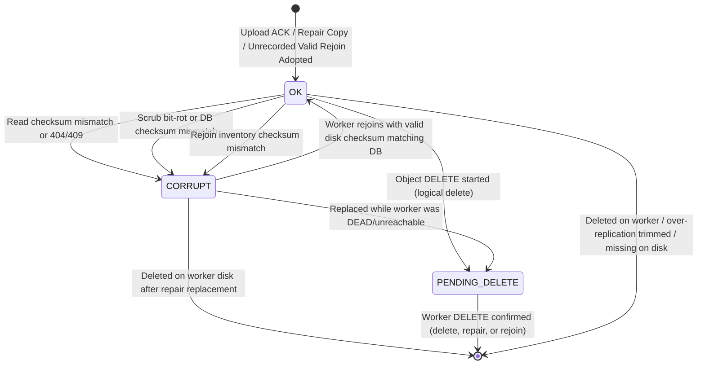
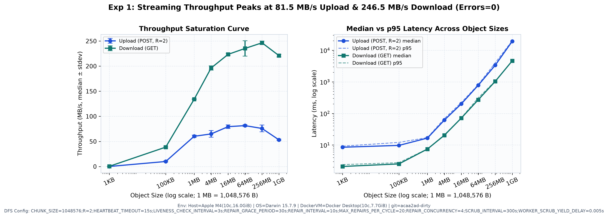
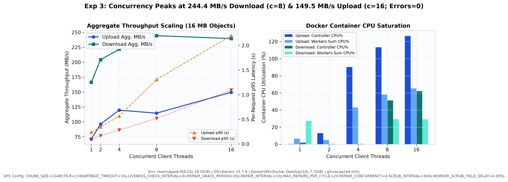
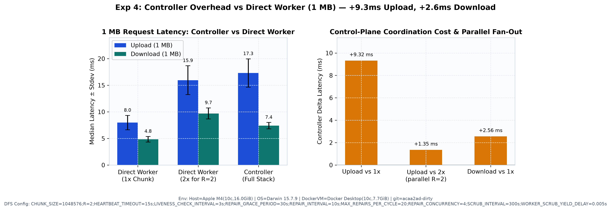
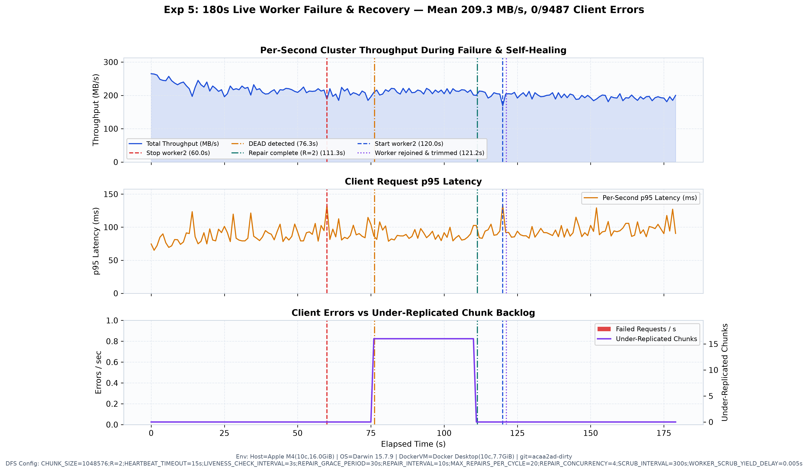
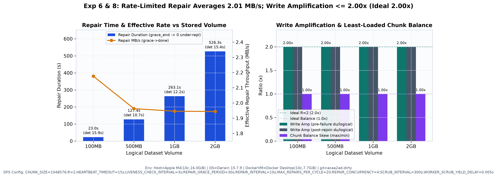
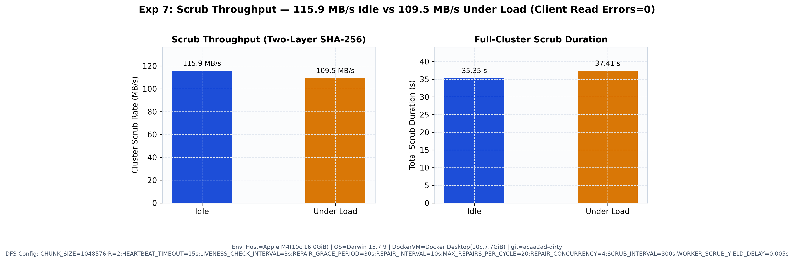

# Technical Engineering Report: Distributed Object Storage System

## 1. Introduction

This report documents the architecture, implementation, failure recovery mechanisms, data integrity verification, observability, and empirical verification of our fault-tolerant Distributed Object Store. Designed around a coordinator-worker topology (`1` controller + `4` stateless-protocol / stateful-disk worker daemons running in Docker Compose), the system provides S3-like HTTP object storage with 1 MiB streaming chunking, replication factor $R = 2$ across distinct failure domains, automatic re-replication on node loss, and two-layer SHA-256 cryptographic integrity verification.

---

## 2. Architecture & Data Model

### System Topology



### Metadata Schema (`controller/db.py`)

Metadata is stored in SQLite (`PRAGMA foreign_keys = ON; journal_mode = WAL; busy_timeout = 5000`) across 6 tables:
1. **`workers`**: `(worker_id PK, address, status IN ('ALIVE','DEAD'), last_heartbeat, dead_since, registered_at)`.
2. **`objects`**: `(object_id PK, name, size, content_type, checksum, chunk_count, status IN ('PENDING','COMMITTED','DELETING'), created_at, modified_at)`.
3. **`chunks`**: `(chunk_id PK, object_id FK ON DELETE CASCADE, idx, size, checksum)` with unique index `(object_id, idx)`. Chunk IDs follow `{object_id}_{idx:06d}`.
4. **`replicas`**: `(chunk_id FK ON DELETE CASCADE, worker_id FK, state IN ('OK','CORRUPT','PENDING_DELETE'))` with composite primary key `(chunk_id, worker_id)`.
5. **`custom_metadata`**: `(object_id FK ON DELETE CASCADE, key, value)` storing up to `64` string keys and `16,384` serialized bytes.
6. **`scrub_status`**: singleton row persisting `(last_scrub_at, chunks_checked, corrupt_found)`.

### Worker Storage Layout (`worker/storage/engine.py`)

Each worker stores chunks sharded by the first two characters of `chunk_id` under `$DATA_DIR/chunks/<prefix>/`:
- `<chunk_id>.chunk`: raw byte payload (up to `1,048,576` bytes).
- `<chunk_id>.sha256`: 64-character hex SHA-256 sidecar committed last via atomic write-temp + `fsync` + `os.replace` + directory `fsync`.

A chunk is considered committed on disk only when both `.chunk` and valid `.sha256` exist; orphan `.tmp` staging files from mid-write `SIGKILL` crashes are purged cleanly during startup recovery.

---

## 3. Core Read, Write & Delete Flows

### Streaming Upload & Atomic Commit (`controller/ingestion.py`)



- **Constant Memory:** Controller reads at most `CHUNK_SIZE` (`1,048,576` B) per chunk via `read_chunk()` and discards each buffer immediately after `persist_chunk()`.
- **Visibility Isolation:** `PENDING` and `DELETING` objects return `404 OBJECT_NOT_FOUND` across `GET /objects/{id}`, `GET/PATCH /metadata`, and are excluded from `GET /objects`.

### Streaming Download & Fallback (`controller/objects_api.py`)

- Pre-flight check reads and SHA-256 verifies Chunk `0` before returning HTTP `200`, allowing clean JSON `500 DATA_CORRUPT` (naming `object_id` and `chunk_idx`) or `503 DATA_UNAVAILABLE` if Chunk `0` fails on all replicas.
- Subsequent chunks (`1..N-1`) stream via `StreamingResponse`. `ALIVE` workers are tried before `DEAD` workers; `WorkerRejected` (`404`/`409`) or SHA-256 mismatch atomically marks the replica `CORRUPT`, wakes `trigger_repair_event`, and seamlessly falls back to the surviving replica. Unrecoverable mid-stream corruption critically logs and raises to abort the HTTP transfer rather than delivering truncated bytes.

### Two-Phase Delete (`controller/lifecycle.py`)

`DELETE /api/v1/objects/{id}` rejects `PENDING` objects with `409 OBJECT_BUSY`. For `COMMITTED` objects, a single transaction sets `objects.status = 'DELETING'` and marks all replica rows `PENDING_DELETE` (immediately hiding the object), then issues bounded parallel `DELETE` requests (`WORKER_DELETE_TIMEOUT = 5.0s`, concurrency `16`). Confirmed replica rows are deleted (`finish_delete_if_empty` cascades the object row); unreachable workers retain `PENDING_DELETE` rows for later cleanup on rejoin.

---

## 4. Placement & Replication Strategy

Chunk placement (`controller/placement.py::choose_workers`) queries all `ALIVE` workers alongside their current `OK` replica count and selects the $R = 2$ distinct workers with the fewest chunks, breaking ties randomly (`rng.random()`).

| Scenario | Selection Behavior |
| --- | --- |
| Fresh cluster (`0` chunks) | Uniform random spread across `worker1..worker4`. |
| Skewed cluster load | Prefers least-loaded healthy workers; excludes workers already holding an `OK` or `CORRUPT` copy of the target `chunk_id`. |
| `< 2` healthy eligible workers | Raises `InsufficientWorkersError` (`503 INSUFFICIENT_WORKERS`) on pre-flight or logs deferral during repair. |

---

## 5. Failure Detection & Recovery

### Failure & Rejoin Timeline

```mermaid
sequenceDiagram
    autonumber
    participant W2 as Worker 2
    participant Ctrl as Controller (Liveness & Repair)
    participant DB as SQLite Metadata
    participant W1 as Surviving Worker 1
    participant W3 as Target Worker 3
    participant C as Client

    W2--xCtrl: Worker 2 stops (heartbeats cease)
    Note over Ctrl,DB: Heartbeat age > HEARTBEAT_TIMEOUT (15s)
    Ctrl->>DB: worker2 status: ALIVE -> DEAD (dead_since=t0)
    C->>Ctrl: GET /api/v1/objects/{id}
    Ctrl->>W1: GET /internal/chunks/c0
    W1-->>Ctrl: Verified bytes -> 200 OK
    Note over Ctrl: Past REPAIR_GRACE_PERIOD (now - dead_since >= 30s)
    Ctrl->>W1: GET /internal/chunks/c0 + verify SHA-256 == DB
    Ctrl->>W3: PUT /internal/chunks/c0 (X-Chunk-Checksum)
    W3-->>Ctrl: 201 Created
    Ctrl->>DB: INSERT replica (c0, worker3, OK) -> 2 valid replicas
    W2->>Ctrl: Worker 2 restarts -> POST /internal/workers/register
    Ctrl->>DB: worker2 DEAD -> ALIVE
    Ctrl-->>W2: 200 OK; schedule async reconcile_worker(worker2)
    Ctrl->>W2: GET /internal/workers/worker2/chunks
    Ctrl->>W2: DELETE excess over-replicated chunks -> back to R=2
```

### Replica State Machine



- **Startup Grace Window:** On controller restart, `liveness_monitor` suppresses `ALIVE -> DEAD` transitions for `HEARTBEAT_TIMEOUT` (`15s`) so workers can resume heartbeats without false positive failures.
- **Repair Grace Period & Backoff:** Chunks missing solely because a host is `DEAD` wait `REPAIR_GRACE_PERIOD` (`30s`) to absorb brief flaps, whereas `CORRUPT` or missing-row chunks repair immediately via `trigger_repair_event`. Cycles run under a single-flight `asyncio.Lock` capped at `MAX_REPAIRS_PER_CYCLE = 20`, `REPAIR_CONCURRENCY = 4`, and `MAX_CHUNK_REPAIR_ATTEMPTS = 5`.
- **Rejoin Reconciliation:** Returning workers immediately receive `200 OK` on registration while `reconcile_worker` runs asynchronously: clearing `PENDING_DELETE` replicas, adopting unrecorded valid copies if `valid_count < 2`, deleting `DELETING` or expired orphan chunks (`>= ORPHAN_SAFETY_TTL_SECONDS = 600s`), preserving active `PENDING` upload chunks, deleting stale missing-on-disk DB rows, and trimming `valid_count > 2` chunks from highest-loaded workers.

---

## 6. Data Integrity & Scrubbing

- **Layer 1 (Worker Local):** Workers verify `<id>.chunk` against `<id>.sha256` on every `GET` (`409 CHUNK_CORRUPT` on mismatch) and compute a fresh streaming SHA-256 across all stored chunks on `POST /internal/scrub`, yielding `WORKER_SCRUB_YIELD_DELAY = 0.005s` between chunks.
- **Layer 2 (Controller Authoritative):** The controller independently hashes downloaded and repaired chunk payloads against SQLite `chunks.checksum` and cross-checks all `checksums` reported by worker scrubs against DB `chunks.checksum`, detecting simultaneous payload + sidecar tampering.
- **Preserve Unrecoverable Data:** Chunks whose replicas are all `CORRUPT` or `DEAD` are never auto-deleted; they are surfaced explicitly as `unrecoverable` or `unavailable` in `GET /api/v1/admin/replication`.

---

## 7. Deployment, CLI & API Usage

Start the cluster cleanly with `docker compose up -d --build` (or `docker compose down -v && docker compose up -d --build` to reset volumes). All client/admin endpoints are exposed via REST on port `8000` and wrapped by `client/objstore.py` (`upload`, `download`, `info`, `patch`, `list`, `delete`, `workers`, `chunks`, `replication`, `scrub`, with optional `--json` flag). Distributed tracing injects/propagates `X-Request-ID` across controller and worker JSON-lines logs.

---

## 8. Demonstration Results & Measured Timings

Observed on a clean 5-container Docker Compose cluster (`DEMO_NON_INTERACTIVE=1 bash scripts/run_all_demos.sh --non-interactive`):

| Demo Script | Scenario Verified | Measured Result & Timing |
| --- | --- | --- |
| `demo_1_storage.sh` | Text + PNG upload, metadata, download, `cmp` + SHA-256 | PASS (~1s) |
| `demo_2_chunking.sh` | `6,500,000` B -> 6 x `1,048,576` B + `208,544` B tail chunk | PASS (~1s) |
| `demo_3_replication.sh` | 2 distinct `OK` replicas per chunk + disk parity on `worker1..4` | PASS (<1s) |
| `demo_4_metadata.sh` | `PATCH` updates/deletes custom keys with 0 chunk `PUT`s/disk writes | PASS (~2s) |
| `demo_5_failure.sh` | 15 MiB file; `worker2` stopped -> read continuity -> repair after 30s grace -> rejoin trim | PASS (~56s) |
| `demo_6_integrity.sh` | 1-replica bit-rot fallback -> scrub + heal; dual corruption -> `500 DATA_CORRUPT` | PASS (~2s) |
| `check_invariants.py` | Post-demo replication, disk SHA-256 parity, orphan, and TTL check | PASS (exit `0`) |

---

## 9. Testing & Invariant Verification

The test suite is split into `tests/unit/` (isolated unit & hardening tests) and `tests/integration/` (live cluster contract, fault-tolerance, stress, and restart matrix suites):

- **Hardening & Unit Coverage (`tests/unit/`):** Covers DB schema/concurrency (`test_db.py`), placement balance (`test_placement.py`), registry/liveness (`test_api.py`), worker storage crash recovery (`test_storage.py`, `test_worker_http.py`, `test_heartbeat.py`), worker HTTP client timeouts/retries (`test_worker_client.py`, `test_replication.py`), streaming upload/download & lifecycle (`test_upload_download.py`, `test_lifecycle.py`), repair/reconciliation/scrubbing (`test_repair.py`, `test_reconciliation.py`, `test_scrubber.py`), CLI subcommands (`test_cli.py`), and JSON error contracts/input bounds/tracing/SQL parameterization (`test_hardening.py`).
- **Live Integration Coverage (`tests/integration/`):** Verifies all endpoints and boundary sizes (`test_endpoints.py`), worker death/re-replication, fast flaps (< grace period), quorum loss (`503 INSUFFICIENT_WORKERS`), `docker pause` timeout fallback, corruption recovery, outage deletes (`test_fault_tolerance.py`), large 250 MiB streams with bounded controller RSS, `10` concurrent uploads + `10` concurrent downloads, `10` concurrent `PATCH`es, 4-stage cluster restart matrix, and `scripts/check_invariants.py` (`test_stress_and_restarts.py`).

---

## 10. Empirical Performance & Scalability Benchmarks (`benchmarks/`)

On the `bench` branch (isolating unmodified `v1.0` application code), we executed an 8-experiment benchmarking suite using pre-generated `os.urandom()` buffers and strict `time.perf_counter()` boundaries on an Apple Silicon Docker Desktop VM (`Apple M4`, 10 cores, `16.0 GiB` host / `7.7 GiB` Linux VM). Full scripts, raw CSVs, and methodology reside in [benchmarks/README.md](../benchmarks/README.md).

### Summary of Measured Results

1. **Streaming Throughput vs Object Size (`1 KB`–`1 GB`, 10 runs/size, `bench_throughput.py`):**
   - Upload throughput rises from `0.11 MB/s` (`1 KB`) and `60.23 MB/s` (`1 MB`) to a peak median of **`81.51 MB/s`** at `64 MB`, then tapers to `75.85 MB/s` (`256 MB`) and `53.12 MB/s` (`1 GB`) as Starlette multipart temp-file spooling and single-stream disk flush contention become dominant.
   - Download throughput rises from `0.47 MB/s` (`1 KB`) and `134.07 MB/s` (`1 MB`) to **`246.50 MB/s`** at `256 MB` (`220.94 MB/s` at `1 GB`), with `0` HTTP errors and `0` post-download SHA-256 mismatches across all sizes.
2. **Small-Object Sequential Latency (`500` reqs/size, `bench_latency.py`):**
   - `1 KB`: Upload `p50=9.02 ms`, `p95=10.22 ms`, `p99=13.63 ms`; Download `p50=2.02 ms`, `p95=2.53 ms`, `p99=3.20 ms`.
   - `10 KB`: Upload `p50=9.07 ms`, `p95=10.69 ms`, `p99=12.67 ms`; Download `p50=1.97 ms`, `p95=2.48 ms`, `p99=6.08 ms`.
   - `100 KB`: Upload `p50=9.86 ms`, `p95=11.24 ms`, `p99=13.35 ms`; Download `p50=2.37 ms`, `p95=2.72 ms`, `p99=5.61 ms`. Zero failures (`0/3,000`).
3. **Concurrency Scaling & Bottlenecks (`1`–`16` clients @ `16 MB`, `bench_concurrency.py`):**
   - Aggregate download scales from `166.34 MB/s` (`c=1`) to **`244.42 MB/s`** (`c=8`, `239.58 MB/s` at `c=16`).
   - Aggregate upload scales from `71.22 MB/s` (`c=1`) to **`149.54 MB/s`** (`c=16`), where `docker stats` confirms controller Python CPU saturates (`126.6%` CPU vs `65.3%` summed across all 4 workers).
4. **Controller Coordination Overhead (`1 MB`, 50 runs, `bench_overhead.py`):**
   - Direct worker (`PUT`): `7.97 ms` (`15.95 ms` at `2x`); Controller (`POST`): `17.30 ms` (**`+9.32 ms`** vs `1x`, only **`+1.35 ms`** vs naive `2x` due to parallel `R=2` fan-out).
   - Direct worker (`GET`): `4.85 ms`; Controller (`GET`): `7.41 ms` (**`+2.56 ms`** for SQLite lookup, streaming, and SHA-256 verification).
5. **180s Live Worker Failure & Recovery Timeline (`bench_failure.py`):**
   - Under `4` concurrent `4 MB` readers + periodic `1 MB/2s` uploads, stopping `worker2` at `t=60.0s` triggered `DEAD` detection at `t=76.26s`, full re-replication back to `R=2` at `t=111.33s` (shortly after the 30s grace period), and sub-2s rejoin + trim at `t=121.23s` after restarting `worker2` at `t=120.01s`. Cluster averaged **209.32 MB/s** with **0 / 9,487 client request errors**.
6. **Repair Speed, Write Amplification & Chunk Balance (`100 MB`–`2 GB`, `bench_repair.py`):**
   - Detection latency across 4 volumes stayed within `10.67–15.94 s`; post-grace active repair sustained **`1.94–2.18 MB/s`** (`22.98 s` for `100 MB`, `127.37 s` for `500 MB`, `263.13 s` for `1 GB`, `526.26 s` for `2 GB`), cleanly bounded by `MAX_REPAIRS_PER_CYCLE=20` per `REPAIR_INTERVAL=10s` (`~2 MB/s`).
   - Pre-failure and post-rejoin `du -sb /data` write amplification remained at **`2.0001x`** (vs ideal `2.0x`), while least-loaded placement yielded near-perfect worker balance (`50/50/50/50`, `250/250/250/250`, `512/512/512/512`, `1024/1023/1025/1024` -> skew **`1.000–1.002x`**).
7. **Full-Cluster Two-Layer Scrubbing (`1 GB` raw/worker, `bench_scrub.py`):**
   - Scrubbing `4,096` chunks (`4,096 MB`) finished in `35.35 s` (**`115.87 MB/s`**) idle and `37.41 s` (**`109.48 MB/s`**, `5.8%` slowdown) under 4 concurrent download clients (`578` x `16 MB` downloads, `0` errors), validating the non-intrusive `0.005 s` per-chunk yield delay.









---

## 11. Limitations & Future Work

1. **Controller Single Point of Failure:** The single controller and local SQLite DB limit write scalability and availability; future work could replicate metadata via Raft/rqlite or stateless controllers over PostgreSQL.
2. **Transport Security & Multi-Tenancy:** Internal and public HTTP APIs currently assume a trusted network; adding TLS/mTLS, bearer/HMAC auth, and tenant namespaces would harden production deployment.
3. **Automatic Cluster Rebalancing:** Newly added workers receive new chunks via least-loaded placement, whereas pre-existing chunks are not proactively migrated unless a repair occurs; a low-priority background rebalancer would eliminate long-term skew after node additions.
4. **Garbage Collection of Unrecoverable Objects:** Objects with all replicas permanently `CORRUPT` are preserved indefinitely for operator inspection rather than automatically expired unless manually deleted.

---

## 12. Conclusion

Through streaming 1 MiB chunking, atomic `PENDING -> COMMITTED` transitions, lease-based heartbeats with grace-period re-replication, asynchronous rejoin reconciliation, two-layer SHA-256 verification with automated disk scrubbing, structured `X-Request-ID` observability, and strict invariant verification, the distributed object storage cluster maintains durability and byte-exact integrity across worker crashes, network pauses, silent disk corruption, concurrent load, and full cluster restarts.
