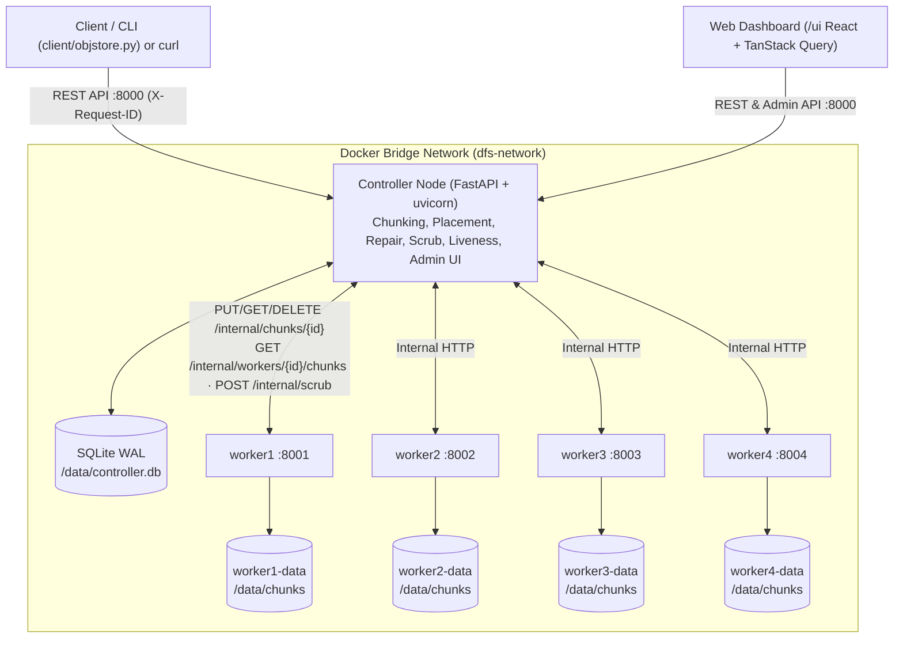
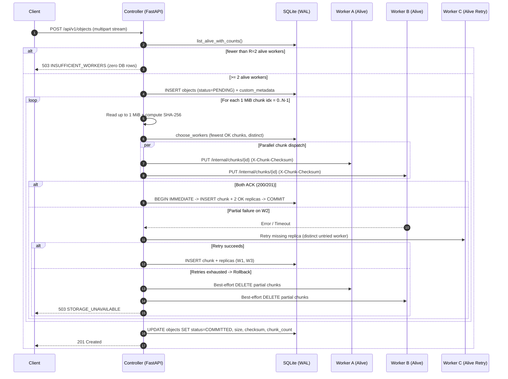
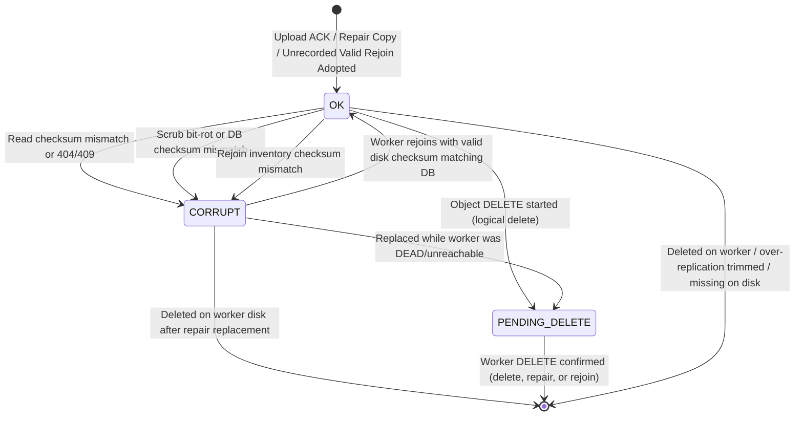
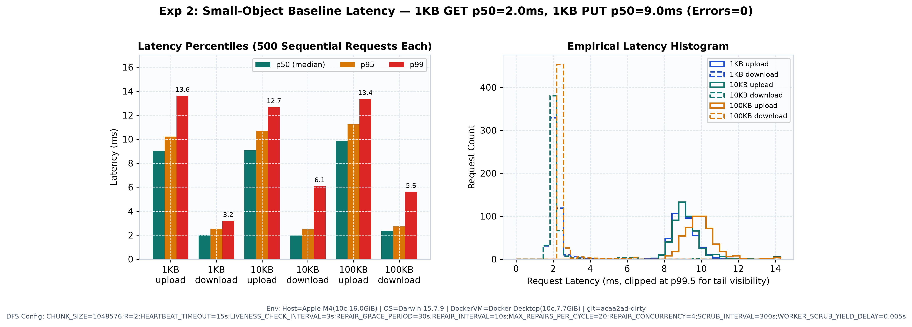

# Technical Engineering Report: Distributed Object Storage System

**Repository:** `cloud_project` · **Architecture:** 1 Coordinator (`controller`) + 4 Stateful Workers (`worker1`–`worker4`) + CLI & React Web Console (`/ui`)  
**Core Parameters:** `1 MiB` (`1,048,576` B) chunking · Replication factor `R = 2` · SQLite WAL metadata · Two-layer SHA-256 verification · Docker Compose deployment

### Team Contributions (Person A & Person B)

| Developer | Primary Domain & Deliverables | Individual Report |
| --- | --- | --- |
| **Person A** | Data Plane (`objects_api.py`, `ingestion.py`, `replication.py`, `lifecycle.py`, `worker_client.py`), Crash-Safe Worker Storage (`worker/`), Client CLI (`upload`/`download`/`patch`/`list`/`delete`), Frontend Objects & Upload/Metadata UI (`ObjectsPage.tsx`, `client.ts`), Live Demos `1`/`2`/`4`, `8` test files, Data-Plane Benchmarks (`Exp 1–4`) | [REPORT_PERSON_A.md](REPORT_PERSON_A.md) |
| **Person B** | Control Plane (`db.py`, `main.py`, `placement.py`, `repair.py`, `reconciliation.py`, `scrubber.py`, `heartbeat.py`), Admin API & Events (`admin_api.py`), Frontend Fleet/Chunk-Map/Events Console (`/ui`), Docker Compose multi-stage build, Live Demos `3`/`5`/`6` & invariants, `11` test files, Resilience Benchmarks (`Exp 5–8`) | [REPORT_PERSON_B.md](REPORT_PERSON_B.md) |
| **Full Matrix** | Exact file-by-file ownership, shared interface seam, live demo script & viva QA mapping | [TEAM_SPLIT.md](TEAM_SPLIT.md) |

---

## Table of Contents

1. [Introduction](#1-introduction)
2. [Architecture & Data Model](#2-architecture--data-model)
3. [Core Read, Write & Delete Flows](#3-core-read-write--delete-flows)
4. [Placement & Replication Strategy](#4-placement--replication-strategy)
5. [Failure Detection & Recovery](#5-failure-detection--recovery)
6. [Data Integrity & Scrubbing](#6-data-integrity--scrubbing)
7. [Deployment, API, CLI & Web Dashboard](#7-deployment-api-cli--web-dashboard)
8. [Demonstration Results & Measured Timings](#8-demonstration-results--measured-timings)
9. [Testing & Invariant Verification](#9-testing--invariant-verification)
10. [Empirical Performance & Scalability Benchmarks](#10-empirical-performance--scalability-benchmarks)
11. [Limitations & Future Work](#11-limitations--future-work)
12. [Conclusion](#12-conclusion)

---

## 1. Introduction

This report documents the design, implementation, fault recovery, cryptographic integrity guarantees, observability, web administration interface, and empirical benchmark evaluation of our Distributed Cloud Object Store. Built around a single FastAPI controller and four stateful HTTP chunk workers orchestrated with Docker Compose, the system delivers S3-style object storage with constant-memory `1 MiB` streaming chunking, `R = 2` replication across distinct failure domains, grace-period re-replication, worker rejoin reconciliation, two-layer SHA-256 integrity scrubbing, and a live React + TypeScript observability console served at `/ui`.

---

## 2. Architecture & Data Model

### System Topology



### Metadata Schema (`controller/db.py` & `controller/admin_api.py`)

Metadata lives in SQLite (`PRAGMA foreign_keys = ON; journal_mode = WAL; busy_timeout = 5000`) with explicit `BEGIN IMMEDIATE` write transactions across **7 tables**:

1. **`workers`**: `(worker_id PK, address, status IN ('ALIVE','DEAD'), last_heartbeat, dead_since, registered_at)`.
2. **`objects`**: `(object_id PK, name, size, content_type, checksum, chunk_count, status IN ('PENDING','COMMITTED','DELETING'), created_at, modified_at)`.
3. **`chunks`**: `(chunk_id PK, object_id FK ON DELETE CASCADE, idx, size, checksum)` with unique index `(object_id, idx)`. Chunk IDs follow `{object_id}_{idx:06d}`.
4. **`replicas`**: `(chunk_id FK ON DELETE CASCADE, worker_id FK, state IN ('OK','CORRUPT','PENDING_DELETE'))` with composite primary key `(chunk_id, worker_id)`.
5. **`custom_metadata`**: `(object_id FK ON DELETE CASCADE, key, value)` storing up to `64` user-defined string keys and `16,384` serialized UTF-8 bytes per object.
6. **`scrub_status`**: singleton row persisting `(last_scrub_at, chunks_checked, corrupt_found)`.
7. **`events`** (`controller/admin_api.py`): `(id PK AUTOINCREMENT, ts, type, severity IN ('INFO','WARN','ERROR'), message, data)` recording cluster state transitions (`ALIVE <-> DEAD`, object commit/delete/rollback, replica corruption, repair, scrub), auto-pruned to the latest `1,000` rows.

### Worker Storage Layout (`worker/storage/engine.py`)

Each worker shards chunks by the first two characters of `chunk_id` under `$DATA_DIR/chunks/<prefix>/`:
- `<chunk_id>.chunk`: raw byte payload (at most `1,048,576` bytes).
- `<chunk_id>.sha256`: 64-character hex SHA-256 sidecar committed last via temp-file write + `fsync` + `os.replace` + directory `fsync`.

A chunk exists on disk only when both `.chunk` and a valid `.sha256` sidecar are present; leftover `.tmp` staging files from mid-write `SIGKILL` crashes are purged cleanly on worker startup (`recovered_tmp`).

---

## 3. Core Read, Write & Delete Flows

### Streaming Upload & Atomic Commit (`controller/ingestion.py`)



- **Constant Memory:** Controller reads at most `CHUNK_SIZE` (`1,048,576` B) per chunk via `read_chunk()` and discards each buffer immediately after `persist_chunk()`.
- **Visibility Isolation:** `PENDING` and `DELETING` objects return `404 OBJECT_NOT_FOUND` on `GET /objects/{id}`, `GET/PATCH /metadata`, and are excluded from `GET /objects`. Client disconnects or partial failures trigger `asyncio.shield(purge_object(...))`, and stale `PENDING` rows older than `PENDING_OBJECT_TTL_SECONDS = 600s` are purged at controller startup.

### Streaming Download & Fallback (`controller/objects_api.py`)

- Pre-flight check reads and SHA-256 verifies Chunk `0` before sending HTTP `200`, allowing clean JSON `500 DATA_CORRUPT` (naming `object_id` and `chunk_idx`) or `503 DATA_UNAVAILABLE` if Chunk `0` fails across all replicas.
- Remaining chunks (`1..N-1`) stream one chunk at a time via `StreamingResponse`. `ALIVE` workers are tried before `DEAD` workers; `WorkerRejected` (`404`/`409`) or SHA-256 mismatch marks the replica `CORRUPT`, wakes `trigger_repair_event`, and fails over to the surviving replica.

### Two-Phase Delete (`controller/lifecycle.py`)

`DELETE /api/v1/objects/{id}` rejects `PENDING` objects with `409 OBJECT_BUSY`. For `COMMITTED` objects, a single transaction sets `objects.status = 'DELETING'` and marks all replica rows `PENDING_DELETE` (immediately hiding the object), then issues bounded parallel `DELETE` calls (`WORKER_DELETE_TIMEOUT = 5.0s`, concurrency `16`). Confirmed replica rows are deleted (`finish_delete_if_empty` cascades the object row); unreachable workers retain `PENDING_DELETE` rows until rejoin reconciliation.

---

## 4. Placement & Replication Strategy

Chunk placement (`controller/placement.py::choose_workers`) ranks all `ALIVE` workers by lowest active `OK` replica count, breaking ties randomly (`rng.random()`) while excluding any worker already holding an `OK` or `CORRUPT` copy of the target chunk.

| Scenario | Placement Behavior |
| --- | --- |
| Fresh cluster (`0` chunks) | Even random distribution across `worker1`–`worker4`. |
| Skewed cluster load | Prefers least-loaded healthy workers; guarantees distinct hosts per chunk. |
| `< 2` eligible `ALIVE` workers | Raises `InsufficientWorkersError` (`503 INSUFFICIENT_WORKERS`) on upload or defers repair. |

---

## 5. Failure Detection & Recovery

### Failure & Rejoin Timeline

```mermaid
sequenceDiagram
    autonumber
    participant W2 as Worker 2
    participant Ctrl as Controller (Liveness & Repair)
    participant DB as SQLite Metadata
    participant W1 as Surviving Worker 1
    participant W3 as Target Worker 3
    participant C as Client

    W2--xCtrl: Worker 2 stops (heartbeats cease)
    Note over Ctrl,DB: Heartbeat age > HEARTBEAT_TIMEOUT (15s)
    Ctrl->>DB: worker2 status: ALIVE -> DEAD (dead_since=t0)
    C->>Ctrl: GET /api/v1/objects/{id}
    Ctrl->>W1: GET /internal/chunks/c0
    W1-->>Ctrl: Verified bytes -> 200 OK
    Note over Ctrl: Past REPAIR_GRACE_PERIOD (now - dead_since >= 30s)
    Ctrl->>W1: GET /internal/chunks/c0 + verify SHA-256 == DB
    Ctrl->>W3: PUT /internal/chunks/c0 (X-Chunk-Checksum)
    W3-->>Ctrl: 201 Created
    Ctrl->>DB: INSERT replica (c0, worker3, OK) -> 2 valid replicas
    W2->>Ctrl: Worker 2 restarts -> POST /internal/workers/register
    Ctrl->>DB: worker2 DEAD -> ALIVE
    Ctrl-->>W2: 200 OK; schedule async reconcile_worker(worker2)
    Ctrl->>W2: GET /internal/workers/worker2/chunks
    Ctrl->>W2: DELETE excess over-replicated chunks -> back to R=2
```

### Replica State Machine



- **Startup Grace Window:** On controller startup, `liveness_monitor` suppresses `ALIVE -> DEAD` transitions for `HEARTBEAT_TIMEOUT` (`15s`) so running workers refresh heartbeats without false failures.
- **Repair Grace Period & Rate Limiting:** Chunks under-replicated solely because a host is `DEAD` wait `REPAIR_GRACE_PERIOD = 30s` to absorb brief container restarts; `CORRUPT` replicas bypass the grace period and trigger immediate repair via `trigger_repair_event`. Cycles run under a single-flight `asyncio.Lock` bounded by `REPAIR_INTERVAL = 10s`, `MAX_REPAIRS_PER_CYCLE = 20`, `REPAIR_CONCURRENCY = 4`, and `MAX_CHUNK_REPAIR_ATTEMPTS = 5`.
- **Rejoin Reconciliation:** Returning workers immediately receive `200 OK` on registration while `reconcile_worker` snapshots DB state before querying disk inventory—clearing `PENDING_DELETE` orphans, adopting valid unrecorded under-replicated chunks, preserving active `PENDING` uploads and `< 600s` orphans, deleting expired/corrupt leftovers, and trimming `valid_count > 2` chunks from highest-loaded workers.

---

## 6. Data Integrity & Scrubbing

- **Layer 1 (Worker Local):** Workers verify `X-Chunk-Checksum` on `PUT`, validate `<id>.chunk` against `<id>.sha256` on every `GET` (`409 CHUNK_CORRUPT` on mismatch), and re-hash every stored chunk during `POST /internal/scrub` with `WORKER_SCRUB_YIELD_DELAY = 0.005s` between chunks to avoid starving foreground traffic.
- **Layer 2 (Controller Authoritative):** The controller independently hashes downloaded and repaired chunk payloads against SQLite `chunks.checksum` and cross-checks worker scrub reports against DB checksums, catching simultaneous `.chunk` + `.sha256` tampering.
- **Unrecoverable Data Preservation:** Chunks whose replicas are all `CORRUPT` or `DEAD` are never auto-deleted; they are surfaced in `GET /api/v1/admin/replication` (`unavailable` / `unrecoverable`) and fail reads deterministically (`500 DATA_CORRUPT` / `503 DATA_UNAVAILABLE`).

---

## 7. Deployment, API, CLI & Web Dashboard

### Deployment & CLI

Build and launch the 5-container Docker Compose cluster (`controller-data` and `worker1-data`–`worker4-data` persistent volumes):

```bash
docker compose up -d --build
bash scripts/check_health.sh
python3 client/objstore.py workers
```

All public and admin routes are exposed on port `8000` with `X-Request-ID` tracing echoed in structured JSON-lines logs across controller and workers, and wrapped by the dependency-free CLI (`client/objstore.py`).

### HTTP Endpoint Summary

| Scope | Endpoints |
| --- | --- |
| **Client Object API** | `POST /api/v1/objects` (`201`), `GET /api/v1/objects/{id}` (`200`), `GET /api/v1/objects/{id}/metadata` (`200`), `PATCH /api/v1/objects/{id}/metadata` (`200`), `DELETE /api/v1/objects/{id}` (`204`), `GET /api/v1/objects` (`200`) |
| **Internal Worker Protocol** | `POST /internal/workers/register`, `POST /internal/workers/heartbeat`, `PUT/GET/DELETE /internal/chunks/{chunk_id}`, `GET /internal/workers/{worker_id}/chunks`, `POST /internal/scrub`, `GET /health` |
| **Admin & Dashboard API** | `GET /api/v1/admin/overview`, `GET /api/v1/admin/events?since=<id>&limit=100`, `GET /api/v1/admin/workers`, `GET /api/v1/admin/objects/{id}/chunks`, `GET /api/v1/admin/replication`, `POST /api/v1/admin/scrub`, `GET /ui` (SPA) |

### Cluster Admin & Client Web Dashboard (`/ui`)

Implemented on the `dashboard` branch using a multi-stage `controller/Dockerfile` (`node:22-alpine` builds `frontend/dist` -> `python:3.12-slim` serves static SPA assets at `/ui`) with isolated backend additions in `controller/admin_api.py`:

- **4 Screens (`frontend/` — React 19, Vite, TypeScript, Tailwind CSS v4, TanStack Query v5, React Router v7):**
  1. **Overview (`/ui/`):** 4 worker cards with client-side ticking heartbeat countdown anchored to `server_time` and `DEAD` grace-period countdowns (`repair starts in Ns`), stacked Replication Health bar, logical vs raw byte footprint, `"Run Scrub Now"`, CLI fault-injection snippets modal (no backend Docker socket access), and Latest 5 Events.
  2. **Objects (`/ui/objects`):** Multi-file drag-and-drop upload queue (`XMLHttpRequest` progress bars, cancel support, custom metadata editor), paginated catalog table, direct streaming download links, and delete confirmation modal.
  3. **Object Detail (`/ui/objects/:id`):** Inline `PATCH` metadata editor and 1.5s live **Interactive Chunk Map** showing per-chunk worker colors, `DEAD`/`CORRUPT`/missing replica overlays, worker filters, `1,024`-chunk pagination, and inspection drawer.
  4. **Events Feed (`/ui/events`):** Incremental `since=<id>` stream filterable by severity and event type, with pause/resume polling, auto-scroll, and relative + ISO UTC tooltips.
- **Polling & Security Guardrails:** TanStack Query polls every `1,500 ms` without request pile-up, pauses automatically when `document.hidden` is true, displays a `"Stale / Controller Unreachable"` banner after 2 consecutive failures while retaining last known state, pairs every status color with an icon and text label, and gates all `/api/v1/admin/*` routes behind `ADMIN_ENABLED` (`403 ADMIN_DISABLED` when `false`).

---

## 8. Demonstration Results & Measured Timings

Observed on a clean 5-container Docker Compose cluster (`DEMO_NON_INTERACTIVE=1 bash scripts/run_all_demos.sh --non-interactive`):

| Demo Script | Scenario Verified | Measured Result & Timing |
| --- | --- | --- |
| `demo_1_storage.sh` | Text (`1,976` B) + PNG (`4,700` B) upload, metadata, download, `cmp` + SHA-256 | PASS (`1s`) |
| `demo_2_chunking.sh` | `6,500,000` B -> 6 x `1,048,576` B + `208,544` B tail chunk | PASS (`1s`) |
| `demo_3_replication.sh` | 2 distinct `OK` replicas per chunk + disk parity on `worker1`–`worker4` | PASS (`1s`) |
| `demo_4_metadata.sh` | `PATCH` updates/deletes custom keys with `0` chunk `PUT`s/disk writes | PASS (`1s`) |
| `demo_5_failure.sh` | `15 MiB` file; `worker2` stopped -> read continuity -> repair after 30s grace -> rejoin trim | PASS (`53s`) |
| `demo_6_integrity.sh` | 1-replica bit-rot fallback -> scrub + heal; dual corruption -> `500 DATA_CORRUPT` | PASS (`2s`) |
| `check_invariants.py` | Post-demo replication, disk SHA-256 parity, orphan, and TTL check | PASS (exit `0`) |

---

## 9. Testing & Invariant Verification

The `pytest` suite comprises **294 collected tests** (`249` unit tests + `45` integration tests):

- **Unit & Hardening Suite (`tests/unit/` — `249` tests):** Covers DB schema/concurrency (`test_db.py`), placement balance (`test_placement.py`), registry/liveness (`test_api.py`), worker atomic disk recovery (`test_storage.py`, `test_worker_http.py`, `test_heartbeat.py`), HTTP client timeouts/retries (`test_worker_client.py`, `test_replication.py`), streaming upload/download & lifecycle (`test_upload_download.py`, `test_lifecycle.py`), repair/reconciliation/scrubbing (`test_repair.py`, `test_reconciliation.py`, `test_scrubber.py`), CLI subcommands (`test_cli.py`), JSON error contracts/bounds/SQL parameterization (`test_hardening.py`), and admin events/overview/403 guard/UI SPA fallback (`test_admin_api.py`).
- **Live Integration Suite (`tests/integration/` — `45` tests):** Verifies all REST endpoints & boundary sizes (`test_endpoints.py`), worker death/re-replication, fast flaps (`< 30s` grace), quorum loss (`503 INSUFFICIENT_WORKERS`), `docker pause` timeout fallback, bit-rot recovery, outage deletes (`test_fault_tolerance.py`), `250 MiB` streams with bounded controller RSS, `10` concurrent uploads + `10` concurrent downloads, `10` concurrent `PATCH`es, 4-stage cluster restart matrix, and `scripts/check_invariants.py` (`test_stress_and_restarts.py`).

---

## 10. Empirical Performance & Scalability Benchmarks

An isolated 8-experiment benchmarking harness (`benchmarks/`, `bench` branch from tag `v1.0`) evaluated throughput, latency, scaling, coordination overhead, failure timelines, repair speed, storage amplification, and scrubbing on an Apple Silicon Docker Desktop VM.

- **Environment:** Apple M4 (`10` cores, `16.0 GiB` RAM), macOS `15.7.9`, Docker Desktop `29.8.0` (`10` vCPUs, `7.7 GiB` VM RAM).
- **Methodology:** Incompressible `os.urandom()` buffers generated outside timers; `1 MB = 1,048,576` B; `time.perf_counter()` wrapped strictly around network transfer; SHA-256 verification and cleanup executed outside timed blocks; zero failed requests dropped (`0` errors observed across all experiments).

| Exp | Experiment | Key Measured Finding |
| --- | --- | --- |
| **1** | Throughput vs Size (`1 KB`–`1 GB`, 10 runs) | Upload peaks at **81.51 MB/s** (`64 MB`) and drops to **53.12 MB/s** (`1 GB`) due to multipart spooling; Download peaks at **246.50 MB/s** (`256 MB`, **220.94 MB/s** @ `1 GB`). |
| **2** | Small-Object Latency (`500` seq reqs/size) | `1 KB`: Upload `p50=9.02 ms` / `p99=13.63 ms`, Download `p50=2.02 ms` / `p99=3.20 ms`; `100 KB`: Upload `p50=9.86 ms` / `p99=13.35 ms`, Download `p50=2.37 ms` / `p99=5.61 ms`. |
| **3** | Concurrency (`1`–`16` threads @ `16 MB`) | Aggregate Download peaks **244.42 MB/s** (`c=8`); Aggregate Upload reaches **149.54 MB/s** (`c=16`), saturating controller CPU (`126.6%` vs `65.3%` workers sum). |
| **4** | Controller Overhead (`1 MB`, 50 runs) | Upload: Direct `1x = 7.97 ms`, `2x = 15.95 ms`, Controller = `17.30 ms` (**+1.35 ms** over `2x` via parallel fan-out). Download: Direct `1x = 4.85 ms`, Controller = `7.41 ms` (**+2.56 ms**). |
| **5** | 180s Failure Timeline (`stop@60s`, `start@120s`) | Mean **209.32 MB/s** with **0 / 9,487 client errors**; `DEAD` @ `76.26s`, repaired to `R=2` @ `111.33s` (`+4.9s` post-grace), rejoined & trimmed @ `121.23s`. |
| **6 & 8** | Repair Speed, Write Amp & Skew (`100 MB`–`2 GB`) | Repair sustains **1.94–2.18 MB/s** (`22.98s` @ `100 MB` to `526.26s` @ `2 GB`), bounded by `20` chunks / `10s`; Write amp **2.0001x**; Worker chunk skew **`1.000–1.002x`**. |
| **7** | Full-Cluster Scrub (`1 GB`/worker, `4,096` chunks) | Idle scrub finishes in `35.35 s` (**115.87 MB/s**); under 4 concurrent readers (`578` x `16 MB` reads = `247.2 MB/s`, `0` errors), finishes in `37.41 s` (**109.48 MB/s**, `5.8%` slowdown). |

### 10.1 Throughput & Small-Object Latency (Experiments 1 & 2)

Single-stream upload scales with payload size up to `64 MB` (`81.51 MB/s`) before Starlette `SpooledTemporaryFile` multipart buffering and `1,024` sequential per-chunk DB transactions reduce `1 GB` uploads to `53.12 MB/s`. Downloads avoid disk spooling and stream directly at up to `246.50 MB/s`. For small objects (`1–100 KB`), per-request metadata + `fsync` overhead dominates (`~9 ms` upload, `~2 ms` download).


*Figure 1: Streaming upload and download throughput (MB/s, median ± stdev) and latency percentiles across 1 KB–1 GB (`0` errors, `0` SHA-256 mismatches).*


*Figure 2: Small-object latency percentiles (p50/p95/p99) and empirical histograms across 500 sequential uploads and downloads per size.*

### 10.2 Concurrency Scaling & Controller Overhead (Experiments 3 & 4)

Aggregate upload throughput nearly doubles from `71.22 MB/s` (`c=1`) to `149.54 MB/s` (`c=16`), where single-process controller Python execution becomes CPU-bound (`126.6%` CPU). At `1 MB`, parallel `R = 2` worker fan-out keeps controller upload latency within `+1.35 ms` of two sequential direct worker writes (`17.30 ms` vs `15.95 ms`).


*Figure 3: Aggregate upload/download throughput (16 MB objects) and container CPU saturation across 1–16 concurrent clients (`docker stats`).*


*Figure 4: 1 MB request latency breakdown comparing Controller paths against 1x and 2x Direct Worker calls.*

### 10.3 Live Failure Timeline, Repair Speed & Storage Efficiency (Experiments 5, 6 & 8)

During `180s` of continuous `4`-reader + periodic-writer traffic, stopping `worker2` causes **zero failed client requests (`0 / 9,487`)** because downloads transparently fail over to surviving replicas while uploads route around the `DEAD` node. Across `100 MB`–`2 GB`, active repair runs linearly at `~2.0 MB/s` (matching the `MAX_REPAIRS_PER_CYCLE=20 / REPAIR_INTERVAL=10s` throttle), while `du -sb /data` confirms `2.0001x` raw storage footprint and `1.000–1.002x` worker chunk balance.


*Figure 5: Per-second throughput, p95 latency, errors, and under-replicated chunk backlog across a 180s outage and rejoin of `worker2`.*


*Figure 6: Repair duration, effective repair MB/s, pre/post-rejoin write amplification, and chunk skew across 100 MB–2 GB.*

### 10.4 Full-Cluster Two-Layer Scrubbing (Experiment 7)

Scrubbing `4,096` `1 MiB` chunks (`~1 GB` raw per worker) completes in `35.35s` (`115.87 MB/s`) idle and `37.41s` (`109.48 MB/s`) under `4` concurrent `16 MB` readers serving `247.19 MB/s` with zero client errors, confirming that `WORKER_SCRUB_YIELD_DELAY = 0.005s` keeps background integrity checking non-intrusive.


*Figure 7: Full-cluster two-layer SHA-256 scrub throughput and duration idle vs under concurrent download load.*

---

## 11. Limitations & Future Work

1. **Controller Single Point of Failure:** Metadata lives in a single SQLite WAL file on the `controller` node; production availability would require replicated consensus metadata (e.g., Raft/rqlite) or stateless controllers backed by clustered PostgreSQL.
2. **Multipart Upload Spooling & Single-Process CPU Ceiling:** Benchmarks (`Exp 1` & `Exp 3`) show Starlette's `request.form()` temp-file spooling limits `1 GB` single-stream uploads to `53.12 MB/s` and Python request parsing saturates controller CPU around `126.6%` at `c=16`. True unspooled multipart streaming or direct presigned worker chunk uploads would lift upload throughput toward the `~245 MB/s` download ceiling.
3. **Transport Security & Multi-Tenancy:** Internal and client HTTP APIs currently assume an isolated Docker bridge network; production deployment would add TLS/mTLS, bearer/HMAC client authentication, and tenant isolation.
4. **Automatic Rebalancing & Unrecoverable GC:** Newly joined nodes receive new placements and repairs via least-loaded selection without proactively migrating existing healthy chunks, and objects whose replicas are all `CORRUPT` are retained indefinitely for manual inspection.

---

## 12. Conclusion

Combining `1 MiB` streaming chunking, atomic `PENDING -> COMMITTED` SQLite WAL transitions, lease-based heartbeats with `30s` grace-period re-replication, asynchronous rejoin reconciliation, two-layer SHA-256 verification with non-intrusive scrubbing, structured `X-Request-ID` logging, and a live React `/ui` observability console, the Distributed Object Store delivers `2.0001x` storage efficiency, near-uniform chunk distribution (`1.000–1.002x`), zero client errors during node crashes (`0 / 9,487`), and verified durability across all 6 required demos, `294` automated tests, and 8 empirical benchmark experiments.
