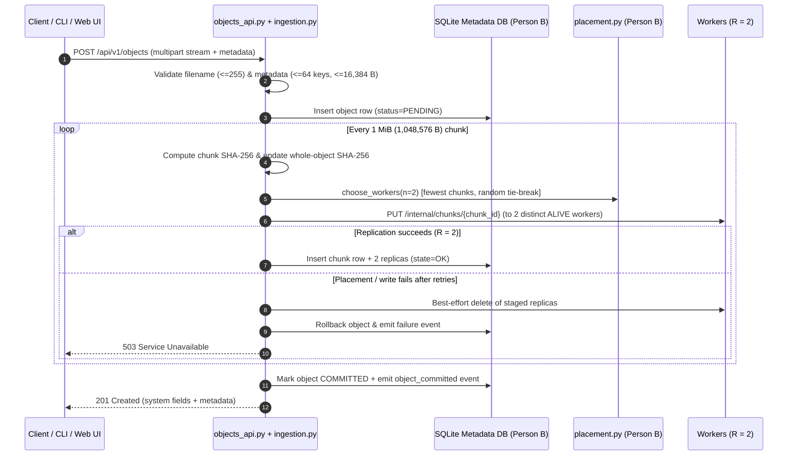
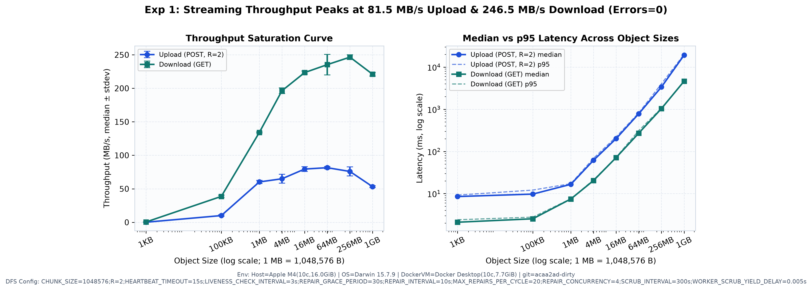
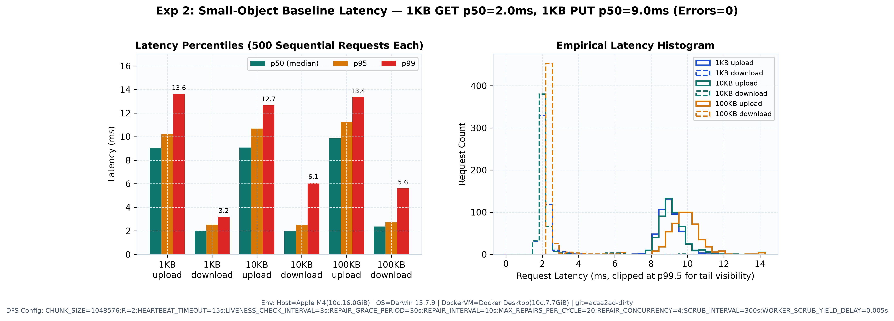
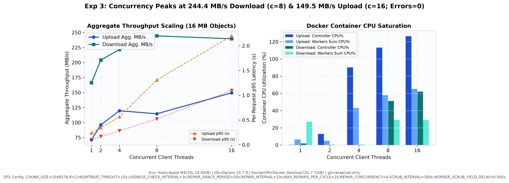
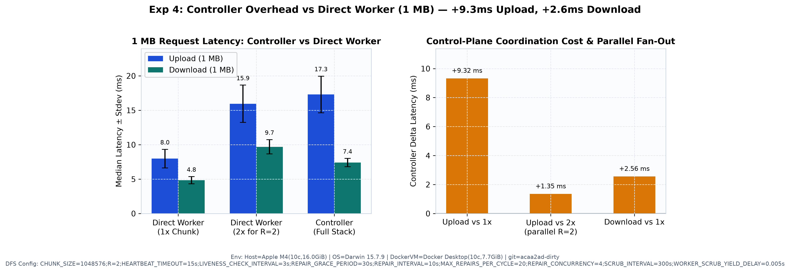

# Individual Technical Report — Person A: Data Plane, Client API & Storage Engine

**Project:** Mini Distributed Cloud Object Storage System (`cloud_project`)  
**Role:** Developer A — Data Plane, Client REST & CLI, Worker Storage Engine, Client UI & Data-Plane Benchmarks (Exp 1–4)  
**Main System Report:** [REPORT.md](REPORT.md) · **Peer Report:** [REPORT_PERSON_B.md](REPORT_PERSON_B.md) · **Ownership Split:** [TEAM_SPLIT.md](TEAM_SPLIT.md)

---

## Table of Contents

1. [Executive Summary & Scope](#1-executive-summary--scope)
2. [Owned Modules & Interface Seam](#2-owned-modules--interface-seam)
3. [Client REST API & Streaming Ingestion](#3-client-rest-api--streaming-ingestion)
4. [Replication, Download Pre-Flight & Lifecycle Guarantees](#4-replication-download-pre-flight--lifecycle-guarantees)
5. [Worker HTTP Daemon & Crash-Safe Storage Engine](#5-worker-http-daemon--crash-safe-storage-engine)
6. [CLI Client & Frontend Object Operations UI](#6-cli-client--frontend-object-operations-ui)
7. [Verification: Unit/Integration Tests & Live Demos (1, 2, 4)](#7-verification-unitintegration-tests--live-demos-1-2-4)
8. [Data-Plane Benchmarks (Exp 1–4)](#8-data-plane-benchmarks-exp-14)
9. [Scoped Limitations & Conclusion](#9-scoped-limitations--conclusion)

---

## 1. Executive Summary & Scope

Person A owns the complete **data-plane request and byte path** from the external client down to on-disk chunk files across `worker1`–`worker4`. Every uploaded object passes through Person A's streaming ingestion pipeline (`1 MiB` = `1,048,576` B chunking, per-chunk and whole-object SHA-256 hashing), synchronous `R = 2` fan-out via a pooled HTTP worker client, and atomic two-file disk writes (`.chunk` payload + `.sha256` commit marker) inside each worker container. On reads, Person A pre-flights chunk `0` and replica availability before returning `StreamingResponse` headers, verifies per-chunk SHA-256 digests on every hop, and triggers failover plus immediate repair signaling when corruption or missing files are discovered.

### Key Verified Contributions

- **7 Controller Data-Plane Modules:** `objects_api.py`, `ingestion.py`, `replication.py`, `lifecycle.py`, `validation.py`, `worker_client.py`, and `errors.py`.
- **Worker Storage Runtime (`worker/`):** HTTP chunk server (`worker/app.py`), atomic sharded disk engine (`worker/storage/engine.py`), config, and structured observability (`worker/worker_obs.py`).
- **Client Surfaces:** CLI subcommands (`upload`, `download`, `info`, `patch`, `list`, `delete`) in `client/objstore.py` + `client/client.py`, and client-facing UI flows (`ObjectsPage.tsx`, XHR progress upload in `api/client.ts`, metadata editing in `ObjectDetailPage.tsx`).
- **Verification & Benchmarking:** `8` owned unit/integration test files (`test_endpoints.py`: `31 passed in 4.29s` on `dashboard`), Demos `1`, `2`, and `4`, and **Experiments 1–4** quantifying throughput (`81.51 MB/s` upload peak, `246.50 MB/s` download peak), small-object latency (`0 / 3,000` errors), concurrency scaling (`149.54 MB/s` aggregate upload at `c=16`), and controller overhead (`+1.35 ms` over 2x direct worker baseline).

---

## 2. Owned Modules & Interface Seam

| Layer | Owned Files | Primary Responsibility |
| --- | --- | --- |
| **Controller API & Pipeline** | [objects_api.py](../controller/objects_api.py), [ingestion.py](../controller/ingestion.py), [replication.py](../controller/replication.py), [lifecycle.py](../controller/lifecycle.py), [validation.py](../controller/validation.py), [worker_client.py](../controller/worker_client.py), [errors.py](../controller/errors.py) | Public REST CRUD/LIST handlers, `1 MiB` streaming chunker, `R = 2` chunk fan-out with retries, two-phase delete, startup rollback janitor, strict input validation, pooled `httpx` worker client |
| **Worker Data Plane** | [worker/app.py](../worker/app.py), [worker/storage/engine.py](../worker/storage/engine.py), [worker/storage/__init__.py](../worker/storage/__init__.py), [worker/config.py](../worker/config.py), [worker/worker_obs.py](../worker/worker_obs.py), [worker/Dockerfile](../worker/Dockerfile) | `PUT`/`GET`/`DELETE /internal/chunks/{chunk_id}`, `GET /health`, deterministic two-character shard storage, staged `.chunk` + `.sha256` commit writes |
| **Client CLI & UI** | [client/objstore.py](../client/objstore.py), [client/client.py](../client/client.py), [ObjectsPage.tsx](../frontend/src/pages/ObjectsPage.tsx), [client.ts](../frontend/src/api/client.ts), [ObjectDetailPage.tsx](../frontend/src/pages/ObjectDetailPage.tsx) | Streaming multipart CLI + HTTP client, React object browser, XHR upload progress bar, metadata `PATCH` editor |
| **Demos & Data-Plane Benchmarks** | [demo_1_storage.sh](../scripts/demo_1_storage.sh), [demo_2_chunking.sh](../scripts/demo_2_chunking.sh), [demo_4_metadata.sh](../scripts/demo_4_metadata.sh), [ensure_demo_files.py](../scripts/ensure_demo_files.py), [local_smoke.sh](../scripts/local_smoke.sh), [bench_throughput.py](../benchmarks/bench_throughput.py), [bench_latency.py](../benchmarks/bench_latency.py), [bench_concurrency.py](../benchmarks/bench_concurrency.py), [bench_overhead.py](../benchmarks/bench_overhead.py) | Live demos `1`, `2`, `4`, smoke script, and Experiments `1`–`4` |

### Contract Across the Seam with Person B

Person A's modules interact with Person B's control plane and SQLite metadata database strictly through well-defined boundaries:

1. **Placement Call:** `ingestion.py` invokes Person B's pure placement function (`placement.choose_workers`) to pick `2` distinct `ALIVE` workers ordered by fewest existing chunks with random tie-breaking.
2. **Metadata State Transitions:** `objects_api.py`, `ingestion.py`, and `lifecycle.py` transition `objects.status` (`PENDING` -> `COMMITTED` / `DELETING`) and `replicas.state` (`OK` / `CORRUPT` / `PENDING_DELETE`) via `controller/db.py`.
3. **Observability & Repair Signals:** Corrupt replicas detected during `fetch_verified_chunk()` set `trigger_repair_event` to wake Person B's repair loop immediately, and object commits/deletes/rollbacks emit events into Person B's `events` table (`admin_api.py`).
4. **Shared Worker Port:** Person A owns `PUT`/`GET`/`DELETE /internal/chunks/{chunk_id}` and `GET /health` on `:8001`–`:8004`; Person B consumes worker inventory (`GET /internal/workers/{worker_id}/chunks`) and scrub (`POST /internal/scrub`).

---

## 3. Client REST API & Streaming Ingestion

Person A exposes six public endpoints under `/api/v1/objects`:

| Method & Path | Status Codes | Behavior |
| --- | --- | --- |
| `POST /api/v1/objects` | `201`, `400`, `503` | Multipart upload (`file` + optional JSON `metadata`); validates filename (`<= 255` chars) & custom metadata (`<= 64` keys, `<= 16,384` B serialized); streams `1 MiB` chunks to `R = 2` workers before returning `COMMITTED` metadata |
| `GET /api/v1/objects/{object_id}` | `200`, `404`, `500`, `503` | Pre-flights chunk `0` and verifies every chunk against DB SHA-256 across replicas with failover; streams assembly with safe `Content-Disposition` escaping |
| `GET /api/v1/objects/{object_id}/metadata` | `200`, `404` | Returns system fields (`object_id`, `name`, `size`, `content_type`, `checksum`, `chunk_count`, `created_at`, `modified_at`) and `metadata` map |
| `PATCH /api/v1/objects/{object_id}/metadata` | `200`, `400`, `404` | Merges or deletes custom keys (`null` removes a key) while enforcing key and byte caps |
| `DELETE /api/v1/objects/{object_id}` | `204`, `404`, `409` | Marks `DELETING` (two-phase delete) and deletes worker chunk replicas + SQLite rows |
| `GET /api/v1/objects` | `200`, `400` | Lists `COMMITTED` objects with pagination (`limit`, `offset`), `prefix` match, and `meta.<key>=<val>` filtering |

- **Timeout & Retry Bounds (`settings.py`):** Per-chunk writes use `UPLOAD_WORKER_TIMEOUT = 10.0s`, worker reads use `WORKER_READ_TIMEOUT = 10.0s`, deletes use `WORKER_DELETE_TIMEOUT = 5.0s`, and chunk fan-out retries up to `MAX_RETRIES_PER_CHUNK = 3` attempts across distinct candidate workers before cleanly rolling back.
- **Zero-Byte Objects:** Supported cleanly with `chunk_count = 0` and an empty SHA-256 digest without allocating worker chunks.

---

## 4. Replication, Download Pre-Flight & Lifecycle Guarantees

### Pre-Flight Verified Downloads (`objects_api.py`)

Before returning `200 OK` on `GET /api/v1/objects/{object_id}`:

1. **Id & State Check:** `check_object_id` validates UUIDv4 syntax and checks `status == 'COMMITTED'` so `PENDING` and `DELETING` objects behave as `404` not found.
2. **Replica Failover & Checksum Enforcement (`fetch_verified_chunk`):** Filters replicas with `state == 'OK'`, tries `ALIVE` workers in shuffled order first (and `DEAD` workers only as a last resort), and verifies `len(data) == chunk["size"]` plus `sha256(data) == chunk["checksum"]`.
3. **Inline Corruption Handling:** Any `404`/`409` rejection or byte/digest mismatch marks that replica `CORRUPT` in SQLite, wakes Person B's repair loop via `trigger_repair_event.set()`, and seamlessly fails over to the peer replica.

### Two-Phase Delete & Rollback Janitor (`lifecycle.py`)

- **Delete Isolation:** `DELETE /api/v1/objects/{object_id}` transitions the object row to `DELETING` so concurrent reads cannot race with replica deletion, executes best-effort chunk cleanup (`WORKER_DELETE_TIMEOUT = 5.0s`), and cleans SQLite rows.
- **Crash Cleanup:** Incomplete `PENDING` uploads older than `PENDING_OBJECT_TTL_SECONDS = 600s` (or stale cleanup tasks on startup) are swept safely without touching active transfers.

---

## 5. Worker HTTP Daemon & Crash-Safe Storage Engine

Each worker container (`worker1`–`worker4`) exposes a stateless HTTP chunk service ([worker/app.py](../worker/app.py)) backed by a crash-safe, sharded filesystem engine ([worker/storage/engine.py](../worker/storage/engine.py)):

- **Deterministic Two-Character Shard Layout (`DATA_DIR/chunks/<first-2-chars>/`):**
  - `<id>.chunk` — raw chunk payload (`MAX_CHUNK_SIZE = 1_048_576` B = `1 MiB`).
  - `<id>.sha256` — hex SHA-256 commit marker written **last**.
  - `.<id>.tmp` & `.<id>.sha256.tmp` — staging files during writes.
- **Atomic Commit & Striping:** Writes are serialized via `64` lock stripes (`_LOCK_STRIPES = 64`), verified against the supplied SHA-256, flushed to staging files, and committed with `<id>.sha256` written last so a crash at any instruction leaves a chunk either completely valid or treated as absent.
- **Idempotency & Conflict Guard:** Re-`PUT`ting the same `chunk_id` with identical digest succeeds idempotently; attempting to overwrite an existing `chunk_id` with mismatched bytes raises `ChunkConflictError` (`409`).

---

## 6. CLI Client & Frontend Object Operations UI

### Python CLI & Client Library ([client/objstore.py](../client/objstore.py), [client/client.py](../client/client.py))

Person A implements all object lifecycle CLI subcommands on top of `ObjStoreClient`:

- `upload <file> [--meta key=val ...]` — Multipart upload with custom metadata pairs.
- `download <object_id> -o <out_path>` — Streaming download with local SHA-256 verification against metadata.
- `info <object_id>` / `list [--prefix P] [--meta K=V]` / `patch <object_id> ...` / `delete <object_id>`.

### Web Console Client Flows (`frontend/src/`)

Within the unified `/ui` React SPA:

- **Objects Browser & Upload Modal ([ObjectsPage.tsx](../frontend/src/pages/ObjectsPage.tsx)):** Searchable/filterable object list displaying size, chunk count, checksum prefix, replication status badge, and delete confirmation, plus an upload modal accepting custom metadata entries.
- **XHR Progress Streaming ([client.ts](../frontend/src/api/client.ts)):** Uses `uploadFileWithProgress` over `XMLHttpRequest` to report live upload progress percentages to the browser before the controller commit returns.
- **Metadata Editor ([ObjectDetailPage.tsx](../frontend/src/pages/ObjectDetailPage.tsx)):** Live `PATCH` form for adding, updating, or removing custom metadata keys paired with direct download controls.

---

## 7. Verification: Unit/Integration Tests & Live Demos (1, 2, 4)

### Owned Automated Test Suites

Person A owns **8 test files** (`7` unit suites in `tests/unit/` + `test_endpoints.py` in `tests/integration/`):

| Test File | Scope Verified |
| --- | --- |
| [test_upload_download.py](../tests/unit/test_upload_download.py) | Streaming `1 MiB` chunking (`0 B`, partial, multi-MiB), SHA-256 checks, partial failure `503` rollback |
| [test_lifecycle.py](../tests/unit/test_lifecycle.py) | Two-phase `DELETING` isolation and stale `PENDING` startup janitor |
| [test_replication.py](../tests/unit/test_replication.py) | `R = 2` fan-out, distinct worker guarantees, `MAX_RETRIES_PER_CHUNK = 3` retry behavior |
| [test_worker_client.py](../tests/unit/test_worker_client.py) | Pooled `httpx` client reuse, read/write/delete timeouts, worker error mapping |
| [test_storage.py](../tests/unit/test_storage.py) | Shard directory pathing, `.chunk` + `.sha256` commit marker semantics, corruption/conflict errors |
| [test_worker_http.py](../tests/unit/test_worker_http.py) | `PUT`/`GET`/`DELETE /internal/chunks/{id}`, `409` mismatch/conflict rejection, idempotent `PUT` |
| [test_cli.py](../tests/unit/test_cli.py) | End-to-end CLI argument parsing and object subcommand dispatch |
| [test_endpoints.py](../tests/integration/test_endpoints.py) | Live multi-container REST API verification (**`31 passed in 4.29s`** on `dashboard`) |

Full unit suite status on `dashboard`: **`249 passed in 17.96s`** (covering both Person A and Person B unit tests).

### Live Demonstrations Owned by Person A

| Script | Duration | Verified Behavior |
| --- | --- | --- |
| [demo_1_storage.sh](../scripts/demo_1_storage.sh) | `1s` | Text and binary (`image/png`) upload (`POST`), download (`GET`), byte-for-byte SHA-256 verification, delete (`DELETE`) |
| [demo_2_chunking.sh](../scripts/demo_2_chunking.sh) | `1s` | Multi-megabyte upload striped into `1 MiB` (`1,048,576` B) chunks across workers, chunk map inspection, binary reassembly |
| [demo_4_metadata.sh](../scripts/demo_4_metadata.sh) | `1s` | Custom metadata attachment (`POST`), key merge/removal (`PATCH`), filtered metadata listing (`GET ?meta.k=v`) |

---

## 8. Data-Plane Benchmarks (Exp 1–4)

All experiments executed on the live 5-container Docker Compose cluster on Apple M4 (`10` cores, `16.0 GiB` RAM, macOS `15.7.9`, Docker Desktop `29.8.0` allocated `10` vCPUs / `7.7 GiB` VM RAM), using pre-generated `os.urandom` payloads and `time.perf_counter()` strictly around network request/response boundaries (`1 MB = 1,048,576` B).

### Summary Metrics (Experiments 1–4)

| Experiment | Workload & Sample Size | Key Measured Results |
| --- | --- | --- |
| **Exp 1:** `bench_throughput.py` | `1 KB`–`1 GB` (`8` sizes, `10` measured runs + `2` warmups each) | **Upload peak:** `81.51 MB/s` (`64 MB`), `53.12 MB/s` (`1 GB`), `60.23 MB/s` (`1 MB`) · **Download peak:** `246.50 MB/s` (`256 MB`), `220.94 MB/s` (`1 GB`), `134.07 MB/s` (`1 MB`) · `0` errors / SHA-256 mismatches |
| **Exp 2:** `bench_latency.py` | `500` sequential reqs/size (`3,000` ops total at `1 KB`, `10 KB`, `100 KB`) | **Upload:** `p50=9.02–9.86 ms`, `p95=10.22–11.24 ms`, `p99=12.67–13.63 ms` · **Download:** `p50=1.97–2.37 ms`, `p95=2.48–2.72 ms`, `p99=3.20–6.08 ms` · `0 / 3,000` errors |
| **Exp 3:** `bench_concurrency.py` | `1`–`16` concurrent threads @ `16 MB` object + `docker stats` | **Download:** peaks `244.42 MB/s` (`c=8`, `239.58 MB/s` @ `c=16`) · **Upload:** reaches `149.54 MB/s` (`c=16`) where **controller CPU hits `126.6%`** vs `65.3%` across all workers combined · `0` errors |
| **Exp 4:** `bench_overhead.py` | `50` runs @ `1 MB` (controller vs persistent-session direct worker) | **Upload:** direct `1x = 7.97 ms`, `2x = 15.95 ms`, controller `17.30 ms` (`+9.32 ms` vs 1x, **`+1.35 ms` vs 2x**) · **Download:** direct `1x = 4.85 ms`, controller `7.41 ms` (`+2.56 ms`) |

### Visual Analysis

*Figure 1 (Exp 1): Upload and download throughput from `1 KB` to `1 GB`. Synchronous `R = 2` write fan-out and Python chunk hashing bound uploads to ~`81.5 MB/s` (`53.12 MB/s` at `1 GB`), while reads saturate single-stream loopback at `246.50 MB/s` (`256 MB`).*

*Figure 2 (Exp 2): `500`-request latency percentiles for small objects. Downloads stay ~`4x` faster than uploads (`~2 ms` vs `~9 ms` median) because reads fetch verified chunks from a single `ALIVE` worker without SQLite commit overhead.*

*Figure 3 (Exp 3): Multi-client throughput scaling (`1`–`16` threads @ `16 MB`). Controller SHA-256 hashing and multipart form handling saturate `126.6%` CPU while combined worker CPU stays at `65.3%`, demonstrating coordinator CPU—not worker disk I/O—is the write bottleneck.*

*Figure 4 (Exp 4): Comparing controller round-trip latency against a `2x` direct worker write baseline leaves **`+1.35 ms`** net proxy/metadata/chunking overhead at `1 MB`, confirming that duplicate `R = 2` payload transfer explains most of the gap over `1x` direct (`7.97 ms`).*

---

## 9. Scoped Limitations & Conclusion

### Identified Data-Plane Bottlenecks

1. **Multipart Form Parsing Spooling:** `POST /api/v1/objects` spools uploaded files beyond `1 MiB` onto temporary storage during Starlette `request.form()` parsing before `1 MiB` chunk streaming starts, explaining the `53.12 MB/s` `1 GB` upload dip relative to `64 MB` (`81.51 MB/s`).
2. **Single-Process Controller Proxy Ceiling:** Because all upload and download bytes traverse the Python controller (`126.6%` CPU at `16` concurrent uploaders), scaling aggregate write bandwidth further would require pre-signed direct-to-worker transfers or a multi-worker/compiled data-plane proxy.

### Conclusion

Person A delivered a crash-safe, strictly checksummed `1 MiB` streaming data plane (`worker/` storage engine + controller `objects_api.py`/`ingestion.py`/`replication.py`/`lifecycle.py`), CLI and React upload/metadata UX, live demos `1`/`2`/`4`, `8` verified test suites, and reproducible microbenchmarks quantifying exact throughput, latency, concurrency CPU saturation, and controller proxy overhead.
