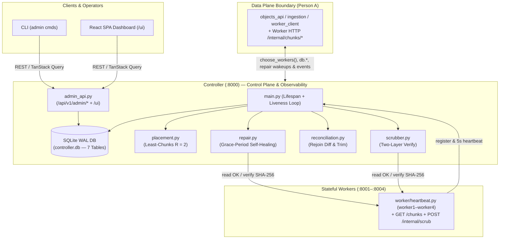
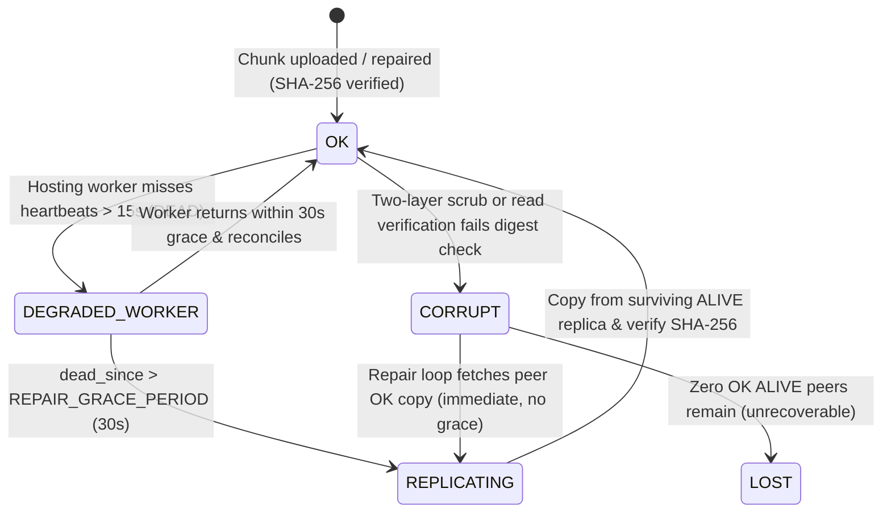
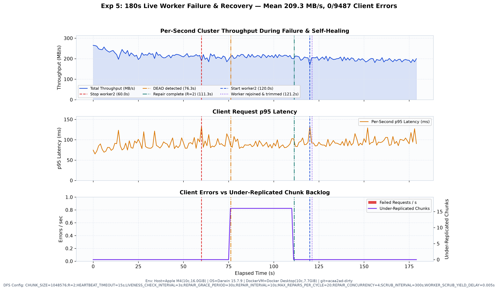
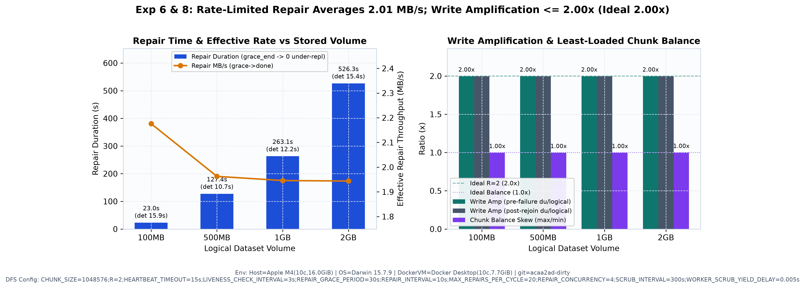
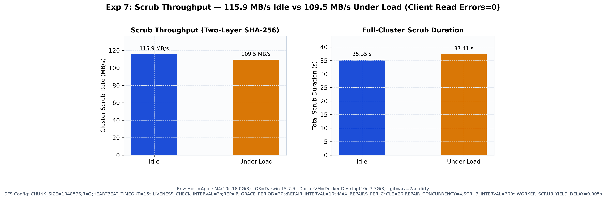

# Individual Technical Report — Person B: Control Plane, Fault Tolerance & Admin Dashboard

**Project:** Mini Distributed Cloud Object Storage System (`cloud_project`)  
**Role:** Developer B — Control Plane, SQLite Metadata DB, Self-Healing, Two-Layer Scrubbing, Admin Dashboard (`/ui`) & Resilience Benchmarks (Exp 5–8)  
**Main System Report:** [REPORT.md](REPORT.md) · **Peer Report:** [REPORT_PERSON_A.md](REPORT_PERSON_A.md) · **Ownership Split:** [TEAM_SPLIT.md](TEAM_SPLIT.md)

---

## Table of Contents

1. [Executive Summary & Scope](#1-executive-summary--scope)
2. [Cluster Topology, Ownership & Interface Seam](#2-cluster-topology-ownership--interface-seam)
3. [SQLite WAL Metadata & Events Schema](#3-sqlite-wal-metadata--events-schema)
4. [Worker Liveness, Least-Loaded Placement & Self-Healing](#4-worker-liveness-least-loaded-placement--self-healing)
5. [Two-Layer Integrity Scrubbing & Rejoin Reconciliation](#5-two-layer-integrity-scrubbing--rejoin-reconciliation)
6. [Admin REST API, React Dashboard (`/ui`) & Container Deployment](#6-admin-rest-api-react-dashboard-ui--container-deployment)
7. [Verification: Unit/Integration Tests, Invariants & Demos (3, 5, 6)](#7-verification-unitintegration-tests-invariants--demos-3-5-6)
8. [Fault-Tolerance, Repair & Scrub Benchmarks (Exp 5–8)](#8-fault-tolerance-repair--scrub-benchmarks-exp-58)
9. [Scoped Limitations & Conclusion](#9-scoped-limitations--conclusion)

---

## 1. Executive Summary & Scope

Person B owns the **cluster brain, durability engine, and observability stack**: worker discovery, heartbeat monitoring, least-loaded placement, SQLite WAL state management (`7` tables), grace-period background re-replication, worker rejoin reconciliation, continuous and on-demand two-layer bitrot scrubbing, the multi-stage Docker Compose deployment, and the React `/ui` cluster admin dashboard.

### Key Verified Contributions

- **Control-Plane Core (`controller/`):** `main.py`, `db.py`, `settings.py`, `placement.py`, `repair.py`, `reconciliation.py`, `scrubber.py`, `obs.py`, `admin_api.py`, plus `worker/heartbeat.py` and `docker-compose.yml`.
- **Observability & Admin Console:** `controller/admin_api.py` (`events` table with `MAX_EVENTS_RETAINED = 1000`, `/api/v1/admin/overview`, `/api/v1/admin/events`, `ADMIN_ENABLED` gating, SPA serving at `/ui`) and React dashboard (`Layout.tsx`, `OverviewPage.tsx`, `ObjectDetailPage.tsx` Chunk Map, `EventsPage.tsx`, TanStack Query polling in `hooks.tsx`, `StatusBadge.tsx`, `DemoCommandsModal.tsx`).
- **Verification & Benchmarking:** `11` owned test suites + shared integration fixtures (`test_admin_api.py` `8` tests; full `tests/unit/` `249 passed in 17.96s` on `dashboard`; `scripts/check_invariants.py`), Live Demos `3`, `5`, `6`, and **Experiments 5–8** proving **zero client errors (`0 / 9,487` requests) during worker stop/restart**, exact `2.0001x` replication write amplification, `1.000–1.002x` uniform chunk balance, and only **`5.8%`** foreground read slowdown under background disk scrubbing.

---

## 2. Cluster Topology, Ownership & Interface Seam

| Layer | Owned Files | Primary Responsibility |
| --- | --- | --- |
| **Control Plane & Schema** | [main.py](../controller/main.py), [db.py](../controller/db.py), [settings.py](../controller/settings.py), [placement.py](../controller/placement.py), [repair.py](../controller/repair.py), [reconciliation.py](../controller/reconciliation.py), [scrubber.py](../controller/scrubber.py), [obs.py](../controller/obs.py), [admin_api.py](../controller/admin_api.py) | FastAPI lifespan loops, 7-table SQLite WAL schema, distinct placement (`R = 2`), grace-period repair, rejoin reconciliation, two-layer scrub, admin REST & events API |
| **Worker Liveness & Infra** | [worker/heartbeat.py](../worker/heartbeat.py), [docker-compose.yml](../docker-compose.yml), [controller/Dockerfile](../controller/Dockerfile), [controller/requirements.txt](../controller/requirements.txt), [pytest.ini](../pytest.ini), [requirements-dev.txt](../requirements-dev.txt) | Background registration + `5s` heartbeats, multi-stage Node/Python controller build, 5-container compose stack, Python test config |
| **Admin CLI & UI Dashboard** | [client/objstore.py](../client/objstore.py) (`workers`, `chunks`, `replication`, `scrub`), [Layout.tsx](../frontend/src/components/Layout.tsx), [StatusBadge.tsx](../frontend/src/components/StatusBadge.tsx), [DemoCommandsModal.tsx](../frontend/src/components/DemoCommandsModal.tsx), [OverviewPage.tsx](../frontend/src/pages/OverviewPage.tsx), [ObjectDetailPage.tsx](../frontend/src/pages/ObjectDetailPage.tsx) (Chunk Map), [EventsPage.tsx](../frontend/src/pages/EventsPage.tsx), [hooks.tsx](../frontend/src/api/hooks.tsx), [schema.d.ts](../frontend/src/api/schema.d.ts), [vite.config.ts](../frontend/vite.config.ts), [package.json](../frontend/package.json) | Admin CLI commands, live fleet cards, replica distribution table, cluster event timeline, Docker fault-injection helper modal |
| **Demos & Resilience Benchmarks** | [demo_3_replication.sh](../scripts/demo_3_replication.sh), [demo_5_failure.sh](../scripts/demo_5_failure.sh), [demo_6_integrity.sh](../scripts/demo_6_integrity.sh), [corrupt_chunk.sh](../scripts/corrupt_chunk.sh), [check_invariants.py](../scripts/check_invariants.py), [harness.py](../benchmarks/harness.py), [bench_failure.py](../benchmarks/bench_failure.py), [bench_repair.py](../benchmarks/bench_repair.py), [bench_scrub.py](../benchmarks/bench_scrub.py), [plot.py](../benchmarks/plot.py) | Live demos `3`/`5`/`6`, invariant validator, benchmark harness, and Experiments `5`–`8` |

---

## 3. SQLite WAL Metadata & Events Schema

All control-plane and observability state persists in `/data/controller.db` (`db.py` + `admin_api.py`), opened with `PRAGMA foreign_keys = ON`, `journal_mode = WAL`, `busy_timeout = 5000`, and serialized `BEGIN IMMEDIATE` transactions across `7` tables:

| Table | Purpose | Exact Schema Columns & States |
| --- | --- | --- |
| `workers` | Cluster node registry | `worker_id`, `address`, `status` (`ALIVE` / `DEAD`), `last_heartbeat`, `dead_since`, `registered_at` |
| `objects` | Object lifecycle & digest | `object_id`, `name`, `size`, `content_type`, `checksum`, `chunk_count`, `status` (`PENDING` / `COMMITTED` / `DELETING`), `created_at`, `modified_at` |
| `chunks` | Ordered chunk mapping | `chunk_id`, `object_id` (`ON DELETE CASCADE`), `idx`, `size`, `checksum` |
| `replicas` | Physical placements (`R = 2`) | `chunk_id` (`ON DELETE CASCADE`), `worker_id`, `state` (`OK` / `CORRUPT` / `PENDING_DELETE`) |
| `custom_metadata` | User key-value tags | `object_id` (`ON DELETE CASCADE`), `key`, `value` |
| `scrub_status` | Singleton scrub summary | `id` (`1`), `last_scrub_at`, `chunks_checked`, `corrupt_found` |
| `events` | Bounded dashboard timeline (`admin_api.py`) | `id`, `ts`, `type`, `severity` (`INFO` / `WARN` / `ERROR`), `message`, `data` (JSON); pruned to keep latest `1,000` rows |

State transitions (`ALIVE <-> DEAD`, repair started/completed/failed, corrupt replica detected, scrub finished, object committed/deleted/rolled back) emit rows safely without recording noisy routine heartbeats.

---

## 4. Worker Liveness, Least-Loaded Placement & Self-Healing

### Placement & Heartbeat Protocol (`placement.py`, `worker/heartbeat.py`, `main.py`)

- **Registration & Heartbeats:** Every worker registers at startup via `POST /internal/workers/register` and reports liveness every `5s` (`POST /internal/workers/heartbeat`).
- **Least-Chunks Distinct Placement (`choose_workers`):** Pure stateless selector picking `n` (`R = 2`) distinct `ALIVE` non-excluded workers sorted by `(chunk_count, rng.random())` — fewest existing chunk replicas first with random tie-breaking.
- **Liveness Monitor:** Every `liveness_check_interval = 3.0s`, the controller marks workers whose `last_heartbeat` age exceeds `heartbeat_timeout = 15.0s` as `DEAD` (`dead_since` populated) and records an alert event.

### Failure Detection, Repair & Replica Lifecycle

- **Grace-Period Re-Replication (`repair.py`):** Every `REPAIR_INTERVAL = 10.0s`, once a worker remains `DEAD` past `REPAIR_GRACE_PERIOD = 30.0s` (or immediately for `CORRUPT` replicas), the repair worker pulls under-replicated chunks in bounded batches (`MAX_REPAIRS_PER_CYCLE = 20`, `REPAIR_CONCURRENCY = 4`, capped at `MAX_CHUNK_REPAIR_ATTEMPTS = 5`), reads an `OK` peer copy from an `ALIVE` worker, writes it to a new candidate worker, and registers the new `OK` replica.

---

## 5. Two-Layer Integrity Scrubbing & Rejoin Reconciliation

### Two-Layer Bitrot Scrubber (`scrubber.py` + `POST /internal/scrub`)

Both background scans (`SCRUB_INTERVAL = 300.0s`) and on-demand runs (`POST /api/v1/admin/scrub`) verify cluster durability across two layers:

1. **Worker Layer (`POST /internal/scrub`):** Each `ALIVE` worker reads its local `.chunk` files, yielding `WORKER_SCRUB_YIELD_DELAY = 0.005s` per chunk (`WORKER_SCRUB_TIMEOUT = 60.0s`) to prevent saturating foreground traffic, and checks payloads against `.sha256` commit markers.
2. **Controller Layer (`scrubber.py`):** Cross-references returned digests and missing chunks against SQLite `chunks.checksum` and `replicas` rows; mismatches or missing files transition replicas to `CORRUPT`, immediately waking the repair loop.

### Worker Rejoin Reconciliation (`reconciliation.py`)

When a stopped or partitioned worker restarts and checks in again:

1. Controller captures a snapshot (`db_reps_snapshot`) and queries `GET /internal/workers/{worker_id}/chunks` for on-disk chunk IDs.
2. **Over-Replicated Trim & Orphan Purge:** Valid replicas already re-replicated elsewhere above `R = 2` (`trim_over_replicated`) and expired orphans older than `ORPHAN_SAFETY_TTL_SECONDS = 600s` (or `DELETING` remnants) are deleted cleanly so cluster invariants converge without wasting disk space.

---

## 6. Admin REST API, React Dashboard (`/ui`) & Container Deployment

All observability extensions on `dashboard` live cleanly inside [admin_api.py](../controller/admin_api.py) and `frontend/` without touching Person A's data-plane request paths:

### Admin Endpoints (`controller/admin_api.py`)

- **Security Gate:** `ADMIN_ENABLED` env var (default `true`; returns `403` across `/api/v1/admin/*` when `false`). No `/var/run/docker.sock` mount or server-side container exec exists.
- **`GET /api/v1/admin/overview`:** Single aggregated snapshot (`server_time`, `workers` with valid/corrupt/pending-delete counts & byte totals, `replication` summary, `totals`, `last_scrub`, `config`, and `objects` table).
- **`GET /api/v1/admin/events?since=<id>&limit=100`:** Incremental cursor-based state-transition feed (`id > since`) and `latest_id`.
- **Control & Inspection Endpoints:** `/api/v1/admin/workers`, `/api/v1/admin/objects/{id}/chunks`, `/api/v1/admin/replication`, `POST /api/v1/admin/scrub`, `/api/v1/admin/placement-test`.

### React SPA Console (`/ui`) & Docker Multi-Stage Build

- **Polling Discipline ([hooks.tsx](../frontend/src/api/hooks.tsx)):** TanStack Query polls every `1500 ms` (`refetchInterval: 1500`), pauses automatically when `document.hidden` is true, and surfaces a **"Stale / Controller Unreachable"** banner after `2` consecutive errors while retaining last known cluster state.
- **Accessible Status Badges ([StatusBadge.tsx](../frontend/src/components/StatusBadge.tsx)):** Pairs icons + explicit labels + colors (`ALIVE`/`HEALTHY` green, `DEGRADED`/`UNDER_REPLICATED` amber, `DEAD`/`CORRUPT` red, `UNKNOWN` grey).
- **Views:** `OverviewPage.tsx` (fleet grid, storage utilization, manual scrub trigger, CLI fault-injection helper modal in `DemoCommandsModal.tsx`), `ObjectDetailPage.tsx` (Chunk Map & per-worker replica matrix), and `EventsPage.tsx` (filterable state-transition log).
- **Packaging ([controller/Dockerfile](../controller/Dockerfile)):** Multi-stage build compiles React/Vite assets in a Node builder stage and serves static files from FastAPI at `/ui` with SPA fallback (optional CORS behind `CORS_ORIGINS`).

---

## 7. Verification: Unit/Integration Tests, Invariants & Demos (3, 5, 6)

### Owned Automated Test Modules (`11` test suites + shared integration fixtures)

- **Unit (`tests/unit/`):** `test_db.py`, `test_placement.py`, `test_api.py`, `test_heartbeat.py`, `test_repair.py`, `test_reconciliation.py`, `test_scrubber.py`, `test_hardening.py`, and **`test_admin_api.py`** (`8` tests covering `/overview`, `/events`, pruning, `ADMIN_ENABLED=false` `403` guard, and SPA fallback).
- **Integration (`tests/integration/`):** `test_fault_tolerance.py`, `test_stress_and_restarts.py`, plus shared test harness files (`tests/conftest.py`, `backends.py`, `conftest.py`, `helpers.py`).
- **Observed Test Status on `dashboard`:** All **`249` unit tests passed in `17.96s`**. Cluster invariant check (`scripts/check_invariants.py`) exited `0` (`OK: all cluster invariants hold`). *(Note: full `test_fault_tolerance.py` and `test_stress_and_restarts.py` passed prior to adding `dashboard`; unit tests and `admin_api.py` checks ran after final edits.)*

### Live Demonstrations & Invariant Script

| Script | Duration | Verified Fault-Tolerance / Integrity Behavior |
| --- | --- | --- |
| [demo_3_replication.sh](../scripts/demo_3_replication.sh) | `1s` | Verifies every chunk holds `2` `OK` replicas on `2` distinct workers (`R = 2`) across multiple objects |
| [demo_5_failure.sh](../scripts/demo_5_failure.sh) | `53s` | Stops `worker2`, waits `15s` `DEAD` detection + `30s` grace period, verifies automatic re-replication back to `R = 2`, restarts `worker2`, and confirms byte-exact download |
| [demo_6_integrity.sh](../scripts/demo_6_integrity.sh) | `2s` | Corrupts a worker chunk replica on disk via `corrupt_chunk.sh`, triggers `POST /api/v1/admin/scrub`, observes automatic `CORRUPT` detection and repair from healthy peer |
| [check_invariants.py](../scripts/check_invariants.py) | `1s` | Asserts `0` non-`COMMITTED` objects, `>= 2` `OK` replicas per chunk, `0` corrupt replicas, `0` orphaned worker chunks (`exit 0`) |

---

## 8. Fault-Tolerance, Repair & Scrub Benchmarks (Exp 5–8)

Benchmark harness (`benchmarks/harness.py`, `plot.py`, `bench_failure.py`, `bench_repair.py`, `bench_scrub.py`) executed against the live 5-container cluster on Apple M4 (`10` cores, `16.0 GiB` RAM, macOS `15.7.9`, Docker Desktop `29.8.0` allocated `10` vCPUs / `7.7 GiB` VM RAM).

### Summary Metrics (Experiments 5–8)

| Experiment | Scenario & Cluster Config | Key Measured Results |
| --- | --- | --- |
| **Exp 5:** `bench_failure.py` | `180s` steady load (`4` concurrent `4 MB` readers + periodic `1 MB / 2s` writer); `stop worker2` @ `60s`, `start worker2` @ `120s` | **Mean throughput:** `209.32 MB/s` · **Client errors:** **`0 / 9,487` requests** · Timeline: **`DEAD` @ `76.26s`** (`+16.26s`), **`repair_complete` @ `111.33s`**, **`worker_rejoined` @ `121.23s`** (`+1.23s`) |
| **Exp 6:** `bench_repair.py` | Stop `worker2` across `100 MB`, `500 MB`, `1 GB`, `2 GB` (`8 MB` objects); measure `DEAD` latency & grace-to-zero repair | **Detection:** `10.67–15.94 s` · **Repair speed:** `1.94–2.18 MB/s` (`22.98 s` @ `100 MB`, `127.37 s` @ `500 MB`, `263.13 s` @ `1 GB`, `526.26 s` @ `2 GB`) |
| **Exp 7:** `bench_scrub.py` | `4,096` chunks (`4,096 MB` / ~`1 GB` raw per worker); compare idle scrub vs `4` concurrent `16 MB` readers | **Idle scrub:** `35.35 s` (`115.87 MB/s`) · **Under read load:** `37.41 s` (`109.48 MB/s`, **`5.8%` slowdown**); `578` foreground reads achieved `247.19 MB/s` with `0` errors |
| **Exp 8:** `bench_repair.py` | Measure container `/data` bytes (`du -sb /data`) & chunk distribution across workers `1–4` up to `2 GB` | **Write amplification:** **`2.0001x`** exact (`4,295,127,040` raw B for `2,147,483,648` logical B) · **Chunk skew:** **`1.000–1.002x`** (`50/50`, `250/250`, `512/512`, `1024/1023/1025/1024`) |

### Visual Analysis

*Figure 1 (Exp 5): Per-second throughput, `p95` latency, and error timeline over a `180s` live `worker2` outage and rejoin. Reads fail over cleanly around the missing node with `0` client errors (`209.32 MB/s` mean) while `DEAD` detection (`76.26s`), repair completion (`111.33s`), and rejoin (`121.23s`) execute cleanly.*

*Figure 2 (Exp 6 & Exp 8): Linear repair scaling (`~2.0 MB/s`) bounded intentionally by controller `REPAIR_CONCURRENCY = 4` / `MAX_REPAIRS_PER_CYCLE = 20` / `REPAIR_INTERVAL = 10s` pacing, paired with near-ideal `2.0001x` write amplification and `1.002x` chunk distribution skew.*

*Figure 3 (Exp 7): Disk scrub throughput remains within **`5.8%`** of idle speed (`109.48` vs `115.87 MB/s`) under `247.19 MB/s` concurrent client read load thanks to `WORKER_SCRUB_YIELD_DELAY = 0.005s` pacing.*

---

## 9. Scoped Limitations & Conclusion

### Identified Control-Plane Trade-Offs

1. **Paced Repair Throughput (`~2.0 MB/s`):** Bounded intentionally (`10s` interval, `20` chunks/cycle) to protect foreground client reads; faster recovery at multi-terabyte scale would require adaptive repair bandwidth control.
2. **Polling-Based Dashboard (`1.5s`) & Single SQLite Coordinator:** TanStack Query polling (`refetchInterval: 1500`) fits single-cluster observability without WebSocket connection state complexity, while single-node SQLite WAL makes the controller stateful (recovery relies on `/data/controller.db`).

### Conclusion

Person B delivered the cluster control plane (`db.py`, `placement.py`, `repair.py`, `reconciliation.py`, `scrubber.py`), fault-tolerance demos (`3`, `5`, `6`), `admin_api.py` + React `/ui` observability console, and resilience benchmarks (`Exp 5–8`), verifying zero-downtime `0 / 9,487` error tolerance through worker failure/rejoin, exact `2.0001x` storage efficiency, and minimal `5.8%` scrub impact under load.
